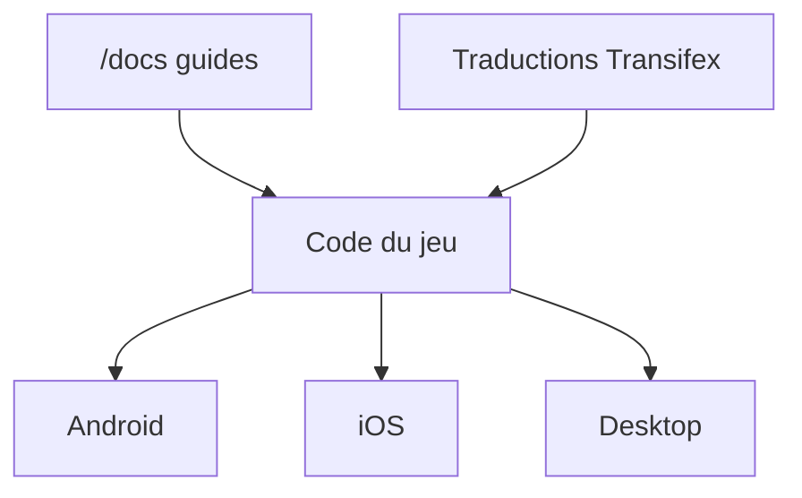

# 00-Evan/shattered-pixel-dungeon

> Open-source roguelike with randomly generated levels for Android, iOS and desktop, derived from Pixel Dungeon.

## The problem
A player wants a classic, free roguelike with many items and generated levels. This repo addresses no data or AI work problem.

## What it actually does
Turn-based dungeon game: random levels and enemies, hundreds of items. The code builds for Android, iOS and desktop. Official versions are distributed through stores. Build guides are in `/docs`.

## How it is wired
Simplified diagram based on the fiche, no diagram provided.



## Trying it
No command in the README; the build guides are in `/docs`.

```bash
# non documenté dans le README : voir /docs (Android, desktop, iOS)
```

## Cost and gotchas
Free; official builds go through stores. The repo does not accept pull requests, only issues. Read the end of the Android guide before any publication on Google Play.

## What it is not
Not a productivity tool or a library. Not a project open to code contributions. The code is provided for reuse, not for collaboration.

## Alternatives
- Pixel Dungeon (Watabou): the original game this one derives from.

## For you
Ignore: it is a game unrelated to data, AI or MLOps, useful only as reading material for game code.
