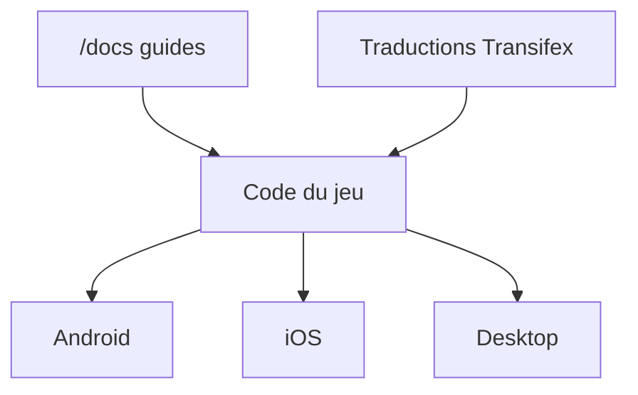

# 00-Evan/shattered-pixel-dungeon

> Roguelike open source à niveaux aléatoires pour Android, iOS et bureau, dérivé de Pixel Dungeon.

## Le problème
Un joueur veut un roguelike classique, libre, avec beaucoup d'objets et de niveaux générés. Ce dépôt n'adresse aucun problème de travail data ou IA.

## Ce que ça fait vraiment
Jeu de donjon au tour par tour : niveaux et ennemis aléatoires, des centaines d'objets. Le code compile pour Android, iOS et bureau. Les versions officielles sont distribuées par des boutiques. Des guides de compilation sont dans `/docs`.

## Comment c'est branché
Schéma simplifié d'après la fiche, sans diagramme fourni.



## Essayer
Aucune commande dans le README ; les guides de compilation sont dans `/docs`.

```bash
# non documenté dans le README : voir /docs (Android, desktop, iOS)
```

## Coût et pièges
Gratuit ; les builds officielles passent par des boutiques. Le dépôt n'accepte pas de pull requests, seulement des issues. Lire la fin du guide Android avant toute publication sur Google Play.

## Ce que ce n'est pas
Pas un outil de productivité ni une bibliothèque. Pas un projet ouvert aux contributions de code. Le code est fourni pour réutilisation, pas pour collaboration.

## Alternatives
- Pixel Dungeon (Watabou) : le jeu d'origine dont celui-ci dérive.

## Pour toi
À ignorer : c'est un jeu sans lien avec la data, l'IA ou le MLOps, utile seulement comme lecture de code de jeu.

