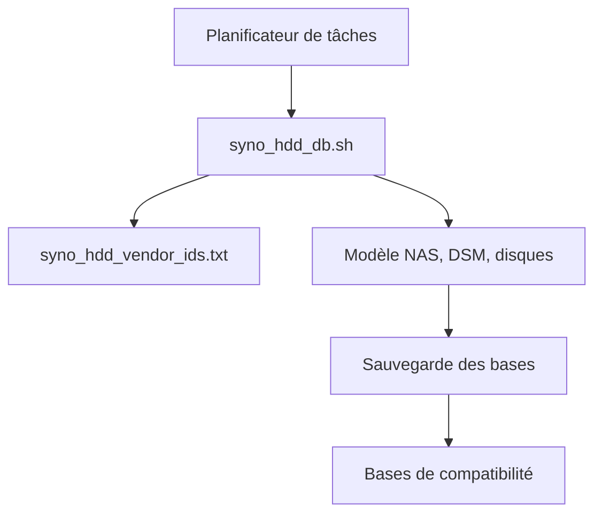

# 007revad/Synology_HDD_db

> Shell script that adds third-party drives to a Synology NAS's compatibility databases.

## The problem
DSM rejects, or flags as incompatible, non-Synology drives and memory.

## What it actually does
Detects the NAS model and DSM version, lists the drives, backs up the databases, then adds the missing drives. Options: block database updates, disable the memory check, enable M.2 volumes and TRIM, disable WDDA, restore the initial state (--restore).

## How it is wired


## Trying it
```bash
sudo -s /path-to-script/syno_hdd_db.sh -nr
sudo -s /path-to-script/syno_hdd_db.sh -nr --showedits
```

## Cost and gotchas
Free. Must be rerun after every DSM update: the README recommends a scheduled task at boot. A reboot may be needed with M.2 drives.

## What it is not
Not a guarantee of Synology support. The README warns: TRIM on SSDs in RAID 5, RAID 6 or SHR with three or more drives can cause data loss depending on the TRIM method. Avoid the -f and -i options unless necessary.

## Alternatives
No alternative named in the README (Synology_enable_M2_card is cited as a complement).

## For you
Worth watching: useful only if you have a Synology NAS with third-party drives to store your data, otherwise irrelevant.
