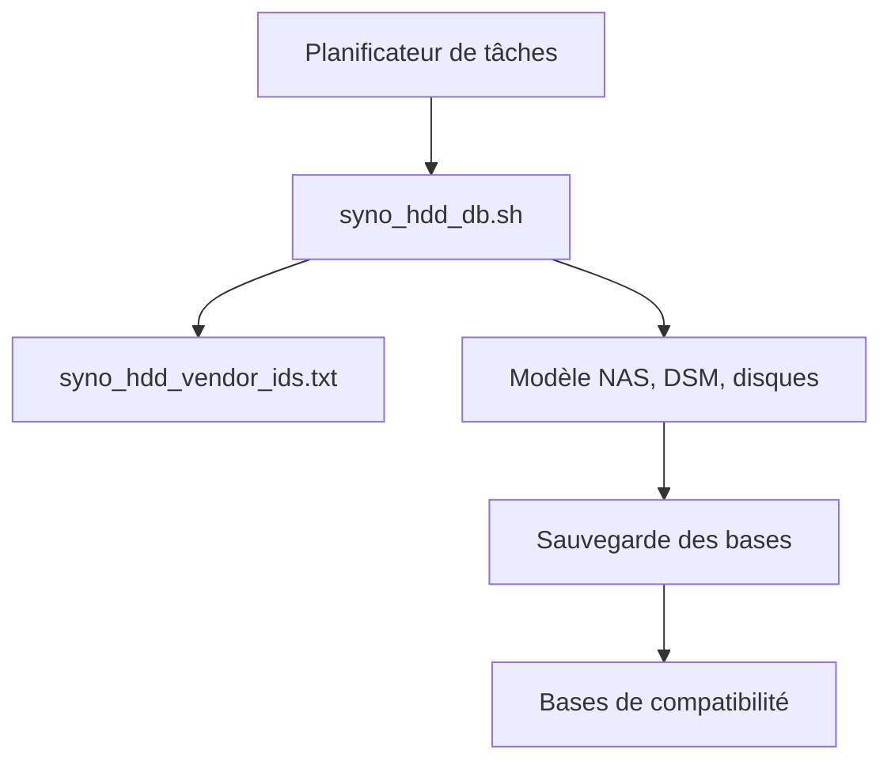

# 007revad/Synology_HDD_db

> Script shell qui ajoute des disques tiers aux bases de compatibilité d'un NAS Synology.

## Le problème
DSM refuse ou signale comme incompatibles les disques et mémoires non Synology.

## Ce que ça fait vraiment
Détecte le modèle de NAS et la version de DSM, liste les disques, sauvegarde les bases puis ajoute les disques manquants. Options : bloquer la mise à jour des bases, désactiver la vérification de mémoire, activer volumes M.2 et TRIM, désactiver WDDA, restaurer l'état initial (--restore).

## Comment c'est branché


## Essayer
```bash
sudo -s /path-to-script/syno_hdd_db.sh -nr
sudo -s /path-to-script/syno_hdd_db.sh -nr --showedits
```

## Coût et pièges
Gratuit. À relancer après chaque mise à jour DSM : le README conseille une tâche planifiée au démarrage. Un redémarrage peut être nécessaire avec des disques M.2.

## Ce que ce n'est pas
Pas une garantie de support Synology. Le README met en garde : TRIM sur SSD en RAID 5, RAID 6 ou SHR à trois disques ou plus peut faire perdre des données selon la méthode TRIM. Les options -f et -i sont à éviter sauf nécessité.

## Alternatives
Aucune alternative nommée dans le README (Synology_enable_M2_card est cité en complément).

## Pour toi
À surveiller : utile seulement si tu as un NAS Synology avec des disques tiers pour stocker tes données, sinon sans objet.

