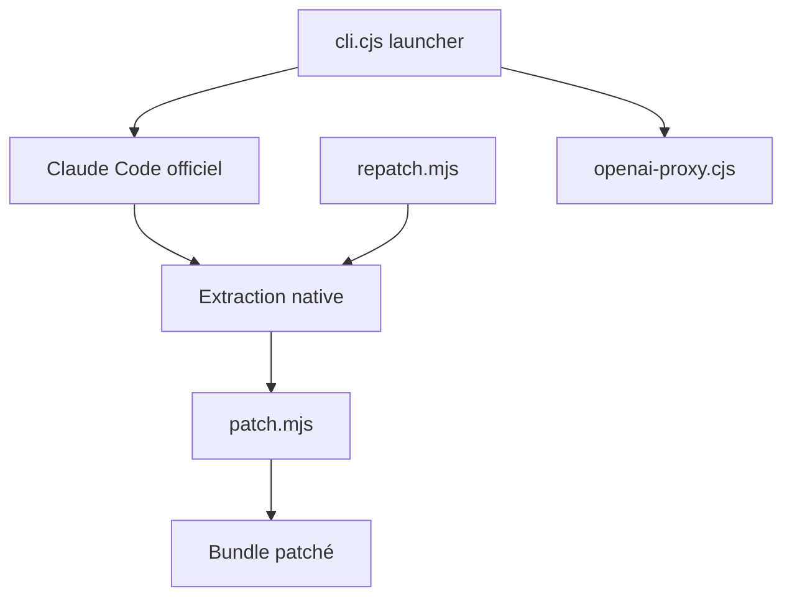

# 0Chencc/clawgod

> A runtime patch that modifies the official Claude Code to unlock features and lift restrictions.

## The problem
Some hidden commands, safety instructions and signals collected by Claude Code cannot be changed by the user. ClawGod aims to take control back.

## What it actually does
It extracts the cli.js embedded in Claude Code's Bun binary, applies 29 regular-expression patches, then runs the result under Bun. It unlocks hidden commands, removes instructions from the system prompt (refusal of security tests, confirmation of destructive actions), neutralises the collection of location and Git origin, and can route to OpenAI-compatible APIs through a local proxy. It re-patches itself on every Claude Code update.

## How it is wired


## Trying it
```bash
curl -fsSL https://github.com/0Chencc/clawgod/releases/latest/download/install.sh | bash
claude update --no-upgrade
bash ~/.clawgod/install.sh --uninstall
```

## Cost and gotchas
Free, but you need Claude Code already installed and an account or API key to use it. It replaces the official launcher and breaks if a patch no longer recognises the upstream code.

## What it is not
Not a third-party client: a patch on Anthropic's binary, which may raise a terms-of-service issue. It removes safeguards (confirmations, safety instructions) that you will have to own. Privacy protection only covers the identified paths.

## Alternatives
No alternative named in the README.

## For you
Ignore: modifying the official binary and removing safeguards is risky and fragile with every update, with no useful gain for serious data or MLOps work.
