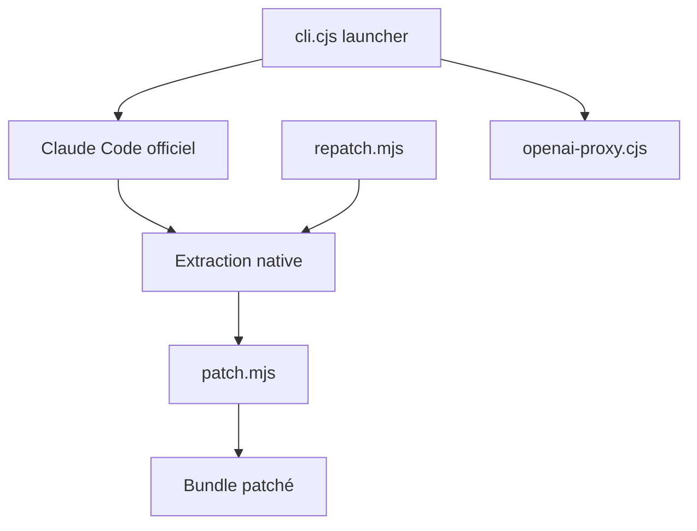

# 0Chencc/clawgod

> Un correctif d'exécution qui modifie Claude Code officiel pour débloquer des fonctions et lever des restrictions.

## Le problème
Certaines commandes cachées, consignes de sécurité et signaux collectés par Claude Code ne sont pas modifiables par l'utilisateur. ClawGod veut en reprendre la main.

## Ce que ça fait vraiment
Il extrait le cli.js embarqué dans le binaire Bun de Claude Code, applique 29 correctifs par expressions régulières, puis lance le résultat sous Bun. Il débloque des commandes cachées, retire des consignes du prompt système (refus de tests de sécurité, confirmation des actions destructrices), neutralise la collecte de localisation et d'origine Git, et peut router vers des API compatibles OpenAI par un proxy local. Il se repatche à chaque mise à jour de Claude Code.

## Comment c'est branché


## Essayer
```bash
curl -fsSL https://github.com/0Chencc/clawgod/releases/latest/download/install.sh | bash
claude update --no-upgrade
bash ~/.clawgod/install.sh --uninstall
```

## Coût et pièges
Gratuit, mais il faut un Claude Code déjà installé et un compte ou une clé d'API pour l'utiliser. Il remplace le lanceur officiel et casse si un correctif ne reconnaît plus le code amont.

## Ce que ce n'est pas
Pas un client tiers : un patch sur le binaire d'Anthropic, ce qui peut poser un problème de conditions d'utilisation. Il retire des garde-fous (confirmations, consignes de sécurité) que tu devras assumer. La protection de la vie privée ne couvre que les chemins identifiés.

## Alternatives
Aucune alternative nommée dans le README.

## Pour toi
À ignorer : modifier le binaire officiel et supprimer des garde-fous est risqué et fragile à chaque mise à jour, sans gain utile pour un travail data ou MLOps sérieux.

