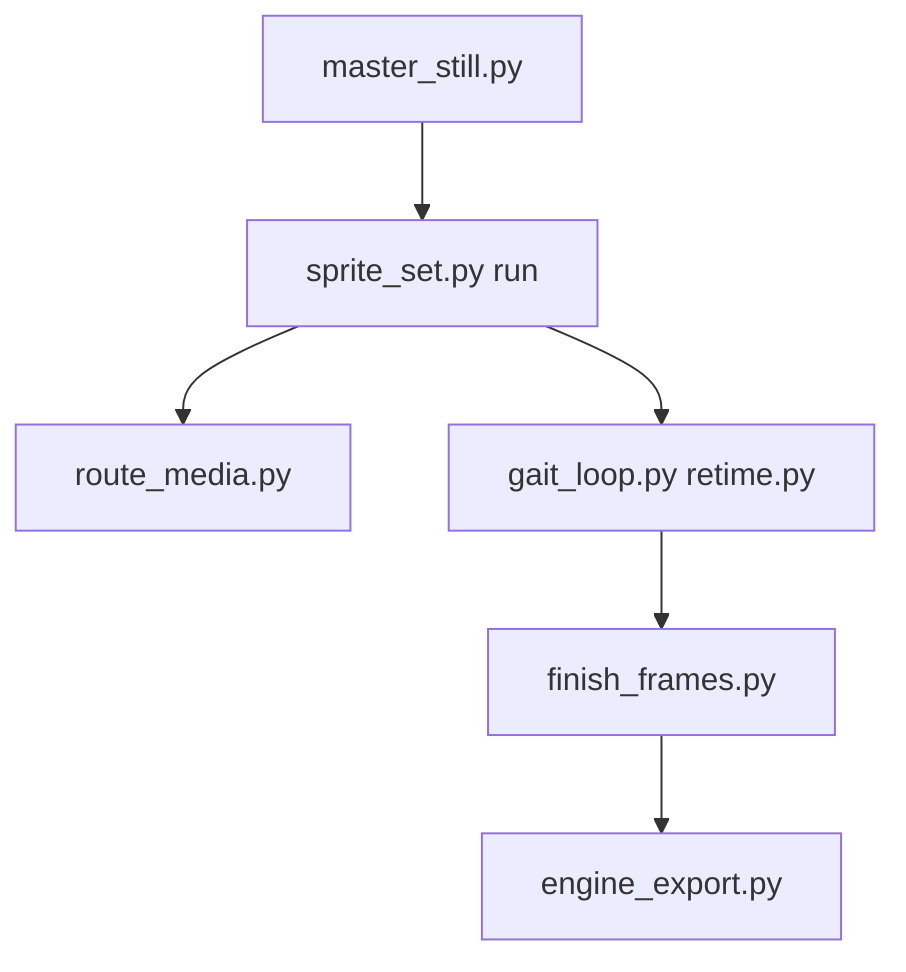

# 0x0funky/agent-sprite-forge

> Agent skills that turn a master image into a complete set of engine-ready 2D sprites.

## The problem
Animating a 2D character requires cutting up image sheets by hand, with unstable fringes and colors.

## What it actually does
Skills for Claude Code, Codex and Grok: the agent generates a master image, then one image-to-video clip per action. Deterministic Python tools filter takes, cut out the subject, realign, loop, retime and export (animation.json, PNG atlas, WebM, Godot, Aseprite, Tiled/LDtk maps). When no model is available, art drawn by code serves as a fallback.

## How it is wired
Simplified diagram based on the sheet, no diagram provided.


## Trying it
```bash
claude plugin marketplace add 0x0funky/agent-sprite-forge --sparse .claude-plugin skills
claude plugin install agent-sprite-forge@agent-sprite-forge
python -m pip install "numpy>=1.26" "Pillow>=10.1" "scipy>=1.11"
```

## Cost and gotchas
Image and video generation through an API key (OpenAI, Gemini, xAI, BytePlus, fal.ai) or through your Codex/Grok subscription. No spending cap by default. ffmpeg 5.1+ required.

## What it is not
Not a game engine. The Godot, LDtk and Aseprite exports have not been opened in their editors, according to the README. README truncated in the source.

## Alternatives
No alternative named in the README.

## For you
Ignore for a data/AI/MLOps profile: specialized in 2D games, no use in your field.
