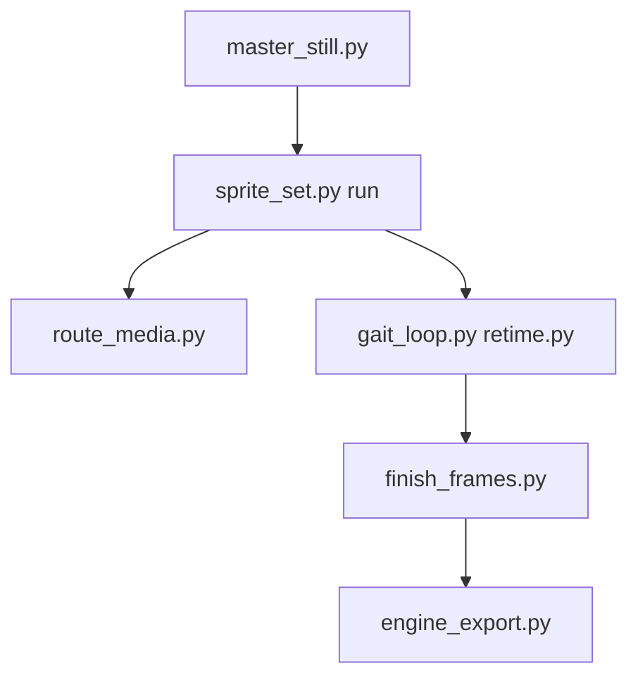

# 0x0funky/agent-sprite-forge

> Compétences d'agent qui transforment une image maîtresse en jeu complet de sprites 2D prêts pour un moteur.

## Le problème
Animer un personnage 2D demande de découper des feuilles d'images à la main, avec franges et couleurs instables.

## Ce que ça fait vraiment
Des compétences pour Claude Code, Codex et Grok : l'agent génère une image maîtresse, puis un clip image-vers-vidéo par action. Des outils Python déterministes filtrent les prises, détourent, recalent, bouclent, recadrent le tempo et exportent (animation.json, atlas PNG, WebM, Godot, Aseprite, cartes Tiled/LDtk). Quand aucun modèle n'est disponible, un art dessiné par code sert de repli.

## Comment c'est branché
Schéma simplifié d'après la fiche, sans diagramme fourni.


## Essayer
```bash
claude plugin marketplace add 0x0funky/agent-sprite-forge --sparse .claude-plugin skills
claude plugin install agent-sprite-forge@agent-sprite-forge
python -m pip install "numpy>=1.26" "Pillow>=10.1" "scipy>=1.11"
```

## Coût et pièges
Génération d'images et de vidéos via clé d'API (OpenAI, Gemini, xAI, BytePlus, fal.ai) ou via ton abonnement Codex/Grok. Aucun plafond de dépense par défaut. ffmpeg 5.1+ requis.

## Ce que ce n'est pas
Pas un moteur de jeu. Les exports Godot, LDtk et Aseprite n'ont pas été ouverts dans leurs éditeurs, d'après le README. README tronqué dans la source.

## Alternatives
Aucune alternative nommée dans le README.

## Pour toi
À ignorer pour un profil data/IA/MLOps : spécialisé dans les jeux 2D, sans usage dans ton métier.

