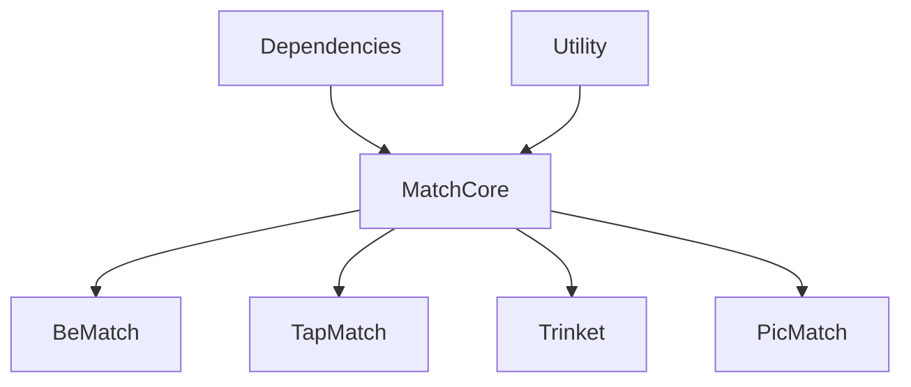

# 0x1-company/ios-monorepo

> Swift monorepo of four iOS credential-exchange apps, with shared business logic.

## The problem
A small team cannot maintain four independent applications.

## What it actually does
A `MatchCore` package (TCA reducers) shares the logic; each brand (BeMatch, TapMatch, Trinket, PicMatch, TenMatch) only has its own interface package. `Utility` and `Dependencies` (swift-dependencies) feed `MatchCore`. The apps let you "like" and then chat after a match.

## How it is wired
Diagram based on the README.



## Trying it
```bash
# Aucune commande documentée dans le README
```

## Cost and gotchas
Free. Building requires Xcode (not in the prerequisites list). Last push in August 2025. GPL-3.0 license (copyleft).

## What it is not
Not a reusable framework: these are a company's applications, and it mainly seeks partners.

## Alternatives
None cited in the README.

## For you
Ignore: an example of TCA architecture for iOS, off-topic for a data / AI / MLOps profile.
