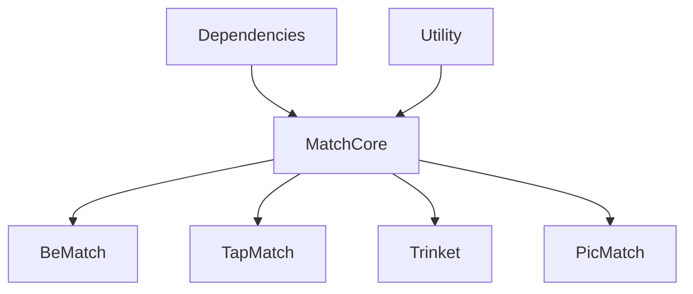

# 0x1-company/ios-monorepo

> Monorepo Swift de quatre applications iOS d'échange d'identifiants, avec une logique métier commune.

## Le problème
Une petite équipe ne peut pas maintenir quatre applications indépendantes.

## Ce que ça fait vraiment
Un paquet `MatchCore` (reducers TCA) partage la logique ; chaque marque (BeMatch, TapMatch, Trinket, PicMatch, TenMatch) n'a que son paquet d'interface. `Utility` et `Dependencies` (swift-dependencies) alimentent `MatchCore`. Les applications permettent de « liker » puis de discuter après un match.

## Comment c'est branché
Schéma d'après le README.



## Essayer
```bash
# Aucune commande documentée dans le README
```

## Coût et pièges
Gratuit. Compilation sous Xcode nécessaire (hors liste des prérequis). Dernier push en août 2025. Licence GPL-3.0 (copyleft).

## Ce que ce n'est pas
Pas un framework réutilisable : ce sont les applications d'une société, qui cherche surtout des partenaires.

## Alternatives
Aucune citée dans le README.

## Pour toi
Ignorer : exemple d'architecture TCA pour iOS, hors sujet pour un profil data / IA / MLOps.

