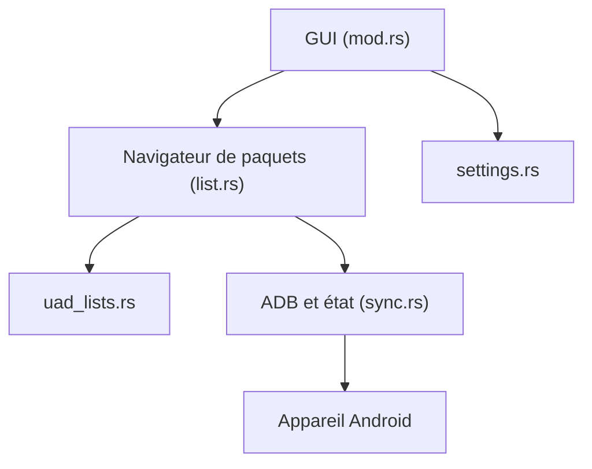

# 0x192/universal-android-debloater

> Desktop application in Rust that uninstalls or disables Android system apps via ADB.

## The problem
Phones ship with system apps (manufacturer, carrier, Google) that cannot easily be removed.

## What it actually does
It lists the packages of a device connected over ADB, cross-references them with documented debloat lists, then uninstalls/disables or restores/re-enables them. It handles multiple users and devices, selection export/import and an action log.

## How it is wired
Diagram based on the one provided, reduced.



## Trying it
```bash
sudo apt install android-sdk-platform-tools
adb devices
```
Then download the latest release for your system (`opengl` version if the Vulkan version does not start).

## Cost and gotchas
Free (GPL-3.0). USB debugging must be enabled and ADB installed. Risk of a bootloop followed by a factory reset if an essential package is removed: back up first. Last push in August 2024.

## What it is not
Not a permanent uninstall without root: system packages may come back after an update. The project describes itself as still at an early stage.

## Alternatives
None named in the README.

## For you
Ignore: smartphone cleanup tool unrelated to your work, and little activity since 2024.
