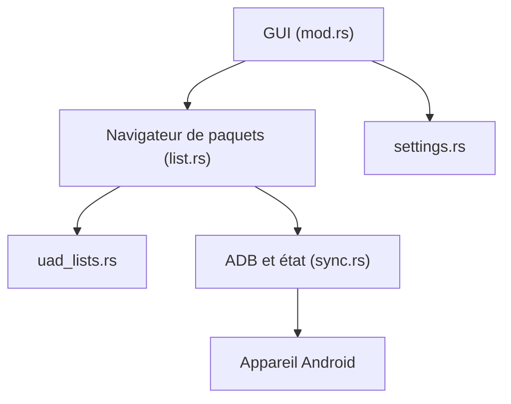

# 0x192/universal-android-debloater

> Application de bureau en Rust qui désinstalle ou désactive les applications système Android via ADB.

## Le problème
Les téléphones embarquent des applications système (constructeur, opérateur, Google) qu'on ne peut pas retirer facilement.

## Ce que ça fait vraiment
Elle liste les paquets d'un appareil connecté en ADB, les croise avec des listes de debloat documentées, puis désinstalle/désactive ou restaure/réactive. Elle gère plusieurs utilisateurs et appareils, l'export/import de sélection et un journal des actions.

## Comment c'est branché
Schéma d'après le diagramme fourni, réduit.



## Essayer
```bash
sudo apt install android-sdk-platform-tools
adb devices
```
Puis télécharger la dernière release pour ton système (version `opengl` si la version Vulkan ne démarre pas).

## Coût et pièges
Gratuit (GPL-3.0). Il faut activer le débogage USB et installer ADB. Risque de bootloop puis réinitialisation d'usine si un paquet essentiel est retiré : sauvegarde préalable. Dernier push en août 2024.

## Ce que ce n'est pas
Pas une désinstallation définitive sans root : les paquets système peuvent revenir après une mise à jour. Le projet se dit encore en phase précoce.

## Alternatives
Aucune alternative nommée dans le README.

## Pour toi
À ignorer : outil de nettoyage de smartphone sans lien avec ton métier, et peu actif depuis 2024.

