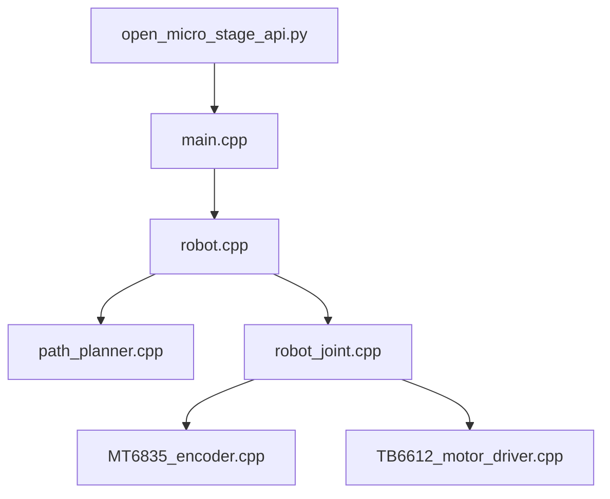

# 0x23/MicroManipulatorStepper

> Open-source motorized XYZ micro-manipulator with submicrometer precision, to build yourself for optics or probing.

## The problem
Commercial submicrometer positioning stages are expensive for optical alignment, electronic probing or microscopy.

## What it actually does
Parallel-kinematics platform with stepper motors and magnetic encoders, servo-controlled at 30 kHz; magnetic gearing gives steps down to 50 nm (resolution, not accuracy). C++ firmware on RP with look-ahead planning, controllable via G-code over USB serial port. Python API and graphical interface provided. FreeCAD CAD and KiCAD electronics.

## How it is wired


## Trying it
```python
from open_micro_stage_api import OpenMicroStageInterface
oms = OpenMicroStageInterface(show_communication=True, show_log_messages=True)
oms.connect('/dev/ttyACM0')
oms.home()
oms.move_to(0.0, 0.0, 0.0, f=10)
```

## Cost and gotchas
Hardware to build: parts listed in a bill of materials that is not up to date for version 4.0, 3D printing with thermal drift or machining. 5-6 V power supply (2 A). The v1.2 board has a via error to fix. A license is present but not identified.

## What it is not
Not software: a hardware project. Absolute accuracy is much worse than the stated resolution.

## Alternatives
No alternative named in the README.

## For you
Ignore: a laboratory instrument to build, outside the data/AI/MLOps scope.
