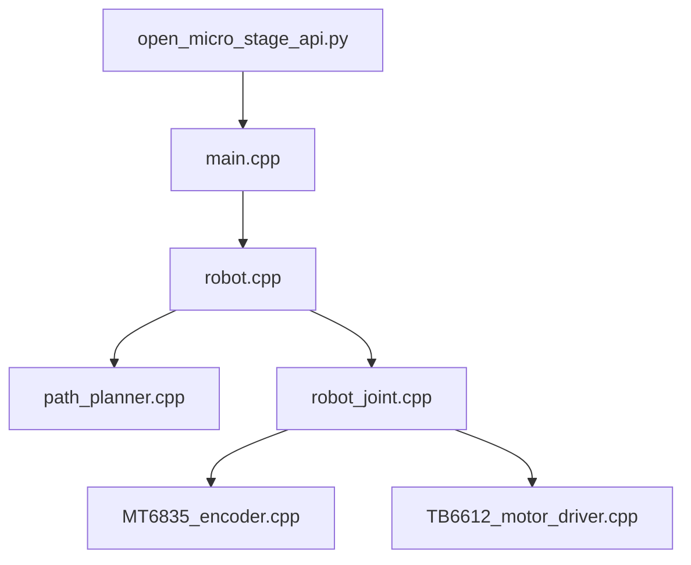

# 0x23/MicroManipulatorStepper

> Micro-manipulateur XYZ motorisé libre à précision submicrométrique, à construire soi-même pour l'optique ou le sondage.

## Le problème
Les platines de positionnement submicrométriques du commerce sont chères pour l'alignement optique, le sondage électronique ou la microscopie.

## Ce que ça fait vraiment
Plateforme à cinématique parallèle avec moteurs pas à pas et codeurs magnétiques, asservie à 30 kHz ; la démultiplication magnétique donne des pas jusqu'à 50 nm (résolution, pas exactitude). Firmware C++ sur RP avec planification à anticipation, pilotable en G-code par port série USB. API Python et interface graphique fournies. CAD FreeCAD et électronique KiCAD.

## Comment c'est branché


## Essayer
```python
from open_micro_stage_api import OpenMicroStageInterface
oms = OpenMicroStageInterface(show_communication=True, show_log_messages=True)
oms.connect('/dev/ttyACM0')
oms.home()
oms.move_to(0.0, 0.0, 0.0, f=10)
```

## Coût et pièges
Matériel à construire : pièces listées dans une nomenclature pas à jour pour la version 4.0, impression 3D avec dérive thermique ou usinage. Alimentation 5-6 V (2 A). La carte v1.2 a une erreur de via à corriger. Licence présente mais non identifiée.

## Ce que ce n'est pas
Pas un logiciel : un projet matériel. Précision absolue nettement moins bonne que la résolution annoncée.

## Alternatives
Aucune alternative nommée dans le README.

## Pour toi
À ignorer : instrument de laboratoire à fabriquer, hors du périmètre data/IA/MLOps.

