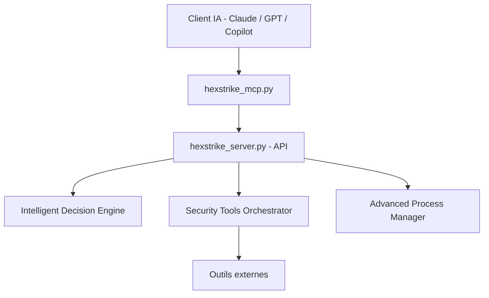

# 0x4m4/hexstrike-ai

> MCP server that gives an AI agent access to over 150 security tools, for authorized testing.

## The problem
Penetration-testing tools are numerous, each with its own options. An AI agent has no standard way to call them.

## What it actually does
Two scripts: `hexstrike_server.py` (REST API, port 8888, orchestrator that launches the tools as subprocesses, LRU cache, process management) and `hexstrike_mcp.py` (FastMCP adapter for Claude Desktop, Cursor, VS Code Copilot). The tools (network, web, binary, cloud, CTF, OSINT) must be installed separately. State is in memory.

## How it is wired


## Trying it
```bash
git clone https://github.com/0x4m4/hexstrike-ai.git
cd hexstrike-ai
python3 -m venv hexstrike-env
source hexstrike-env/bin/activate
pip3 install -r requirements.txt
python3 hexstrike_server.py
curl http://localhost:8888/health
```

## Cost and gotchas
Free, but you must install the third-party tools yourself and have an MCP-compatible AI client. The README warns that the agent gets broad system access (an `/api/command` entry point that executes commands): isolated VM, no authentication documented.

## What it is not
The README's figures ("24x faster", 98.7% detection rate) are not sourced. "v7.0" is announced, not delivered. Legitimate use: testing with written authorization, in-scope bug bounty, CTF, research on systems you own.

## Alternatives
- GreyDGL/PentestGPT: step-based pipeline, resumable sessions.
- aliasrobotics/cai: security agent framework, archived.

## For you
Worth watching: a textbook case for plugging tools into an agent via MCP, but the execution surface is broad, the claimed performance cannot be verified and use assumes a strict legal framework.
