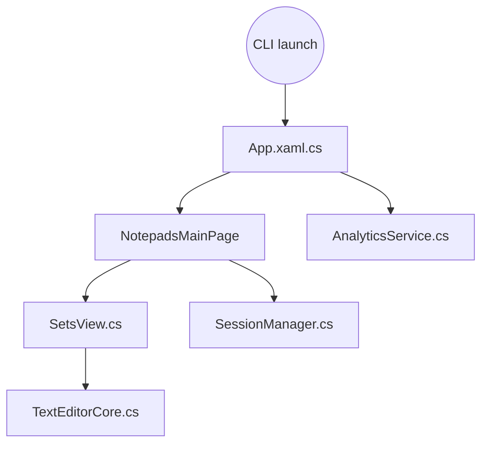

# 0x7c13/Notepads

> Lightweight tabbed Windows text editor, with Markdown preview and diff comparison.

## The problem
Windows Notepad is too basic, and Notepad++ or VS Code are judged too heavy by the author for simple notes.

## What it actually does
Tabbed UWP editor, command-line launch, live Markdown preview, side-by-side comparison, session restore. Files are limited to 1 MB and some system folders are forbidden for writing.

## How it is wired



## Trying it
```bash
winget install "Notepads App"
notepads %FilePath%
```

## Cost and gotchas
Free, Windows only (UWP). The author uses AppCenter for usage statistics and error telemetry, without reading files according to the README.

## What it is not
Not a code editor, nor a tool for large files (1 MB limit). A personal project of the author, not a product of their employer.

## Alternatives
No alternative named in the README as a replacement choice (Notepad++, VS Code and Sublime are cited as heavy tools).

## For you
Ignore: a simple Windows editor; your VS Code or IDE already does all of this, with data extensions on top.
