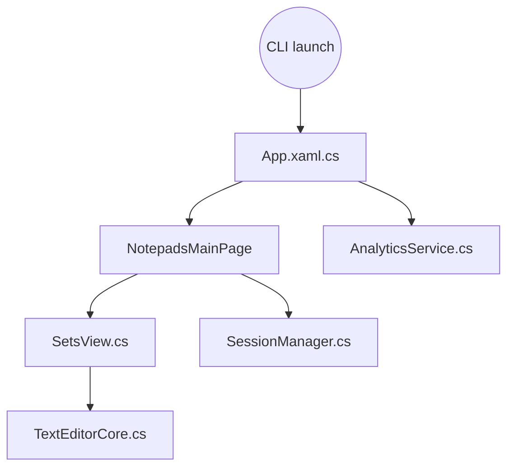

# 0x7c13/Notepads

> Éditeur de texte Windows léger à onglets, avec aperçu Markdown et comparaison de différences.

## Le problème
Le Bloc-notes Windows est trop sommaire, et Notepad++ ou VS Code sont jugés trop lourds par l'auteur pour de simples notes.

## Ce que ça fait vraiment
Éditeur UWP à onglets, lancement en ligne de commande, aperçu Markdown en direct, comparateur côte à côte, reprise de session. Les fichiers sont limités à 1 Mo et certains dossiers système sont interdits en écriture.

## Comment c'est branché



## Essayer
```bash
winget install "Notepads App"
notepads %FilePath%
```

## Coût et pièges
Gratuit, Windows seulement (UWP). L'auteur utilise AppCenter pour des statistiques d'usage et de la télémétrie d'erreurs, sans lire les fichiers selon le README.

## Ce que ce n'est pas
Pas un éditeur de code, ni un outil pour gros fichiers (limite à 1 Mo). Projet personnel de l'auteur, pas un produit de son employeur.

## Alternatives
Aucune alternative nommée dans le README comme choix de remplacement (Notepad++, VS Code et Sublime sont cités comme outils lourds).

## Pour toi
À ignorer : simple éditeur Windows ; ton VS Code ou ton IDE fait déjà tout cela, avec les extensions data en plus.

