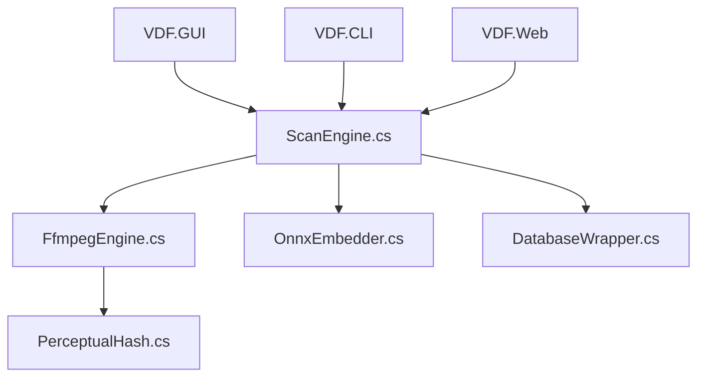

# 0x90d/videoduplicatefinder

> Cross-platform software that finds duplicate videos and images by similarity, even cropped or recompressed.

## The problem
Duplicate tools compare identical files and miss the same video at another resolution, frame rate or with a watermark.

## What it actually does
A single scan engine, used by a desktop app, a CLI and a web server. It extracts frames with FFmpeg, computes perceptual fingerprints and compares. Options: audio fingerprint for partial clips, and DINOv2 embeddings via ONNX Runtime for transformed copies, locally on CPU. A cached database speeds up rescans.

## How it is wired


## Trying it
```bash
vdf-cli scan-and-compare --include /path/to/media
vdf-cli scan-and-compare --include /mnt/media --action lowest-quality --dry-run
docker run -d --name vdf-web -p 8080:8080 -v vdf-db:/root/.config/VDF -v vdf-state:/root/.local/state/VDF -v /path/to/your/media:/media:ro ghcr.io/0x90d/vdf-web:latest
```

## Cost and gotchas
Free, AGPL-3.0. FFmpeg and FFprobe are required (downloaded on first launch). The AI downloads about 100 MB once. Automatic deletion is discouraged: always run a `--dry-run` first. The web interface must not be exposed on the Internet.

## What it is not
Not a cloud service: nothing is sent. The README screenshots are flagged as outdated.

## Alternatives
No alternative named in the README.

## For you
Watch: the fingerprints plus local embeddings approach is reusable to deduplicate a video or image corpus before training.
