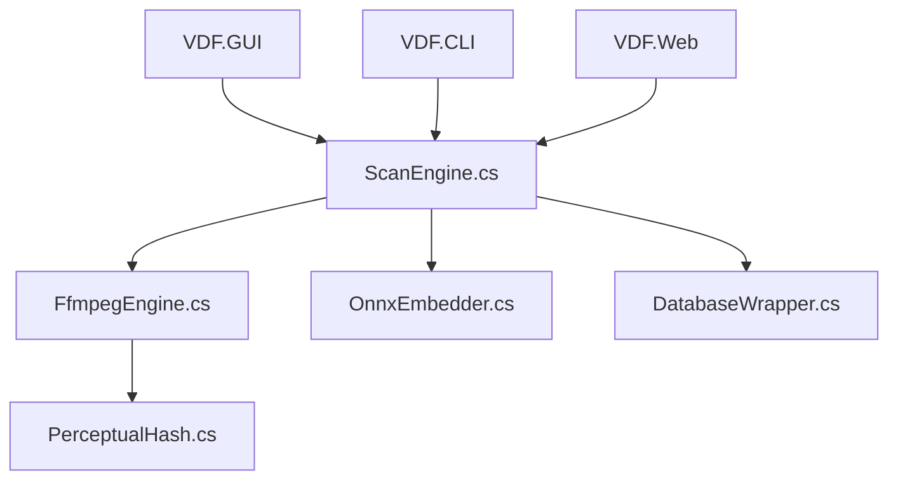

# 0x90d/videoduplicatefinder

> Logiciel multiplateforme qui retrouve les vidéos et images en double par similarité, même recadrées ou recompressées.

## Le problème
Les outils de doublons comparent des fichiers identiques et ratent une même vidéo en autre résolution, cadence ou avec filigrane.

## Ce que ça fait vraiment
Un moteur de scan unique, utilisé par une appli de bureau, un CLI et un serveur web. Il extrait des images avec FFmpeg, calcule des empreintes perceptuelles et compare. Options : empreinte audio pour les extraits partiels, et embeddings DINOv2 via ONNX Runtime pour les copies transformées, en local sur CPU. Une base mise en cache accélère les rescans.

## Comment c'est branché


## Essayer
```bash
vdf-cli scan-and-compare --include /path/to/media
vdf-cli scan-and-compare --include /mnt/media --action lowest-quality --dry-run
docker run -d --name vdf-web -p 8080:8080 -v vdf-db:/root/.config/VDF -v vdf-state:/root/.local/state/VDF -v /path/to/your/media:/media:ro ghcr.io/0x90d/vdf-web:latest
```

## Coût et pièges
Gratuit, AGPL-3.0. FFmpeg et FFprobe sont requis (téléchargés au premier lancement). L'IA télécharge environ 100 Mo une fois. La suppression automatique est déconseillée : toujours un `--dry-run` d'abord. L'interface web ne doit pas être exposée sur Internet.

## Ce que ce n'est pas
Pas un service cloud : rien n'est envoyé. Les captures du README sont signalées comme périmées.

## Alternatives
Aucune alternative nommée dans le README.

## Pour toi
À surveiller : l'approche empreintes plus embeddings locaux est réutilisable pour dédupliquer un corpus vidéo ou image avant entraînement.

