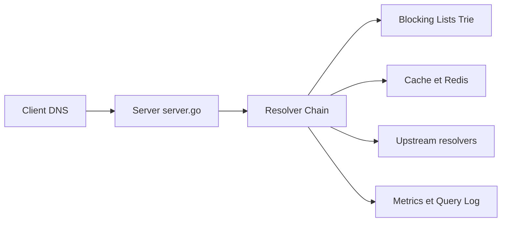

# 0xERR0R/blocky

> DNS proxy and ad blocker in Go for local networks, configured in YAML.

## The problem
Block ads and malicious domains across a whole network, with different rules per client group, without a database to maintain.

## What it actually does
A chain of resolvers: blocking by lists (domain, CNAME, IP), allow lists per client group, custom DNS redirects, conditional forwarding, cache with prefetching, DoH, DoT, DoQ, DNSSEC validation. Query log (CSV, MySQL, PostgreSQL), Prometheus metrics, REST API and CLI. The README claims it collects no telemetry.

## How it is wired

## Trying it
No command documented in the README: it points to the Installation chapter of the online documentation.

## Cost and gotchas
Free, single binary or multi-architecture Docker image (x86-64, ARM, MIPS). Redis is optional to share the cache.

## What it is not
Not an authoritative DNS server: it is a proxy and a filter. Blocking depends on the external lists you choose.

## Alternatives
No alternative named in the README.

## For you
Adopt it if you have a lab or a home network: lightweight, with Prometheus metrics and Grafana dashboards ready to plug into your observability stack.
