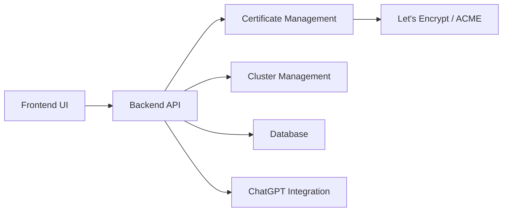

# 0xJacky/nginx-ui

> Web interface to administer Nginx: sites, certificates, logs, cluster, in a single binary.

## The problem
Editing Nginx configurations, renewing certificates and monitoring several servers by hand is error-prone.

## What it actually does
Site editing with a block editor or Ace (LLM completion), automatic test then Nginx reload.
One-click Let's Encrypt certificates with renewal, versioned config backup, encrypted export.
Server statistics, Nginx logs, web terminal, multi-node cluster management.
ChatGPT assistant and MCP interface for agents; Go backend + Vue frontend.

## How it is wired


## Trying it
```bash
nginx-ui -config app.ini
bash -c "$(curl -L https://cloud.nginxui.com/install.sh)" @ install
docker compose up -d
```

## Cost and gotchas
Free, AGPL-3.0; the Docker image mounts `/var/run/docker.sock`, which is root access to the host.
Assumes the Debian `sites-available`/`sites-enabled` layout.

## What it is not
Not a reverse proxy: it drives an existing or embedded Nginx.
Public demo uses admin/admin: do not leave default credentials.

## Alternatives
No alternative named in the README.

## For you
Ignore for your profile: a web administration tool, with no specific data/ML use.
