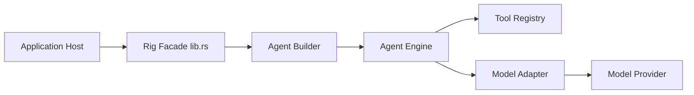

# 0xPlaygrounds/rig

> Rust library for LLM applications, and a terminal coding agent extensible through Bevy plugins.

## The problem
Build LLM agents in Rust with several providers and vector databases under a single interface.

## What it actually does
Two products: the library (more than 20 model providers, more than 10 vector stores, agents with tools, streaming, hooks, embeddings, audio and image, OpenTelemetry, record/replay) and the `rig` agent, whose tools, commands and terminal view are plugins listed in `plugins.toml`. It recompiles with `/reload`; can be driven through pipes in JSON.

## How it is wired


## Trying it
```bash
cargo install rig
rig
cargo add rig
```
The agent authenticates with `/login` or a variable such as `OPENAI_API_KEY`.

## Cost and gotchas
Free, MIT; model usage is billed by the provider. Rust 1.97.1 minimum, Linux and macOS for the agent. Version 0.44.0: the API may still change.

## What it is not
Not an MLOps platform nor a Python framework. WASM support is announced for the core, not verified here.

## Alternatives
No alternative named in the README.

## For you
Keep an eye on it: interesting if you build agents in Rust; in Python, better to stay with your current ecosystem.
