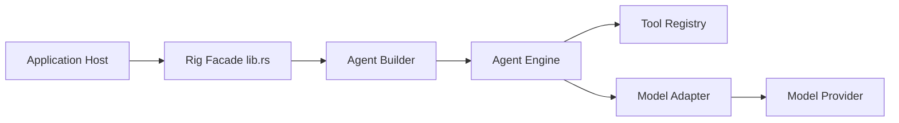

# 0xPlaygrounds/rig

> Bibliothèque Rust pour applications LLM, et agent de code en terminal extensible par plugins Bevy.

## Le problème
Construire des agents LLM en Rust avec plusieurs fournisseurs et bases vectorielles sous une même interface.

## Ce que ça fait vraiment
Deux produits : la bibliothèque (plus de 20 fournisseurs de modèles, plus de 10 vector stores, agents avec outils, streaming, hooks, embeddings, audio et image, OpenTelemetry, enregistrement/rejeu) et l'agent `rig`, dont outils, commandes et vue terminal sont des plugins listés dans `plugins.toml`. Il se recompile avec `/reload` ; pilotable par pipes en JSON.

## Comment c'est branché


## Essayer
```bash
cargo install rig
rig
cargo add rig
```
L'agent s'authentifie avec `/login` ou une variable comme `OPENAI_API_KEY`.

## Coût et pièges
Gratuit, MIT ; l'usage des modèles est facturé par le fournisseur. Rust 1.97.1 minimum, Linux et macOS pour l'agent. Version 0.44.0 : l'API peut encore bouger.

## Ce que ce n'est pas
Pas une plateforme MLOps ni un cadre Python. Le support WASM est annoncé pour le cœur, non vérifié ici.

## Alternatives
Aucune alternative nommée dans le README.

## Pour toi
Surveiller : intéressant si tu fais des agents en Rust ; en Python, mieux vaut rester sur ton écosystème actuel.

