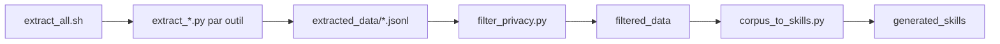

# 0xSero/ai-data-extraction

> Python scripts that extract your conversation histories from coding assistants (Claude Code, Cursor, Codex…) into JSONL.

## The problem
The histories of your coding assistants are scattered across proprietary formats (JSONL, SQLite) and unusable as they are for fine-tuning.

## What it actually does
One script per tool (Claude Code, Codex, Cursor GUI and CLI, Trae, Windsurf, Continue, Gemini CLI, OpenCode) detects installations, reads local storage and writes conversations as JSONL (messages, code context, diffs, tools, timestamps). Two optional steps: `filter_privacy.py` (openai/privacy-filter model, weights of about 2.8 GB) and `corpus_to_skills.py` which synthesizes Agent Skills via an OpenAI-compatible LLM.

## How it is wired


## Trying it
```bash
python3 extract_claude_code.py
python3 extract_cursor.py
./extract_all.sh
python3 filter_privacy.py extracted_data --output-dir filtered_data
```

## Cost and gotchas
Free, standard library only for the extraction. The extracted data may contain proprietary code, API keys and personal paths: filter them and scan for secrets before any sharing. Close the source tool if the SQLite database is locked.

## What it is not
Not a guarantee of anonymization: the privacy filter reduces risk, with no assured compliance. No license declared. The README carries a January 2025 date while describing more recent features.

## Alternatives
No alternative named in the README.

## For you
Worth watching: useful for building a corpus from your own histories, provided you filter, but unlicensed and run by a single person.
