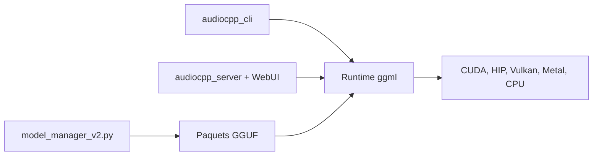

# 0xShug0/audio.cpp

> ggml-based C++ engine that runs audio models locally (speech synthesis, transcription, separation), for developers.

## The problem
Trying out audio models means juggling many Python environments and their dependency conflicts.

## What it actually does
Provides a single native runtime for 143 audio model families (TTS, ASR, voice cloning, separation, music, VAD, diarization) via a CLI, a server API and an embedded WebUI. Backends: CUDA, HIP/ROCm, Vulkan, Metal, WebGPU, CPU. Models are distributed in GGUF.

## How it is wired
Simplified diagram based on the sheet, no diagram provided.



## Trying it
```bash
brew tap 0xShug0/audio-cpp
brew trust 0xShug0/audio-cpp
brew install audio-cpp
audiocpp_server --ui --ui-management --backend cuda
audiocpp_model_manager install qwen3_asr_0_6b_q8_0 --models-dir models
```

## Cost and gotchas
Free, but models are heavy and a GPU helps a lot. Packages are also available in Docker. The HIP kernels and several backends are still marked experimental or in testing.

## What it is not
It is not a single model: it is an engine that loads many. The speed figures come from the README, with no independent measurement. The license exists but is not identified by GitHub.

## Alternatives
No alternative named in the README (it compares itself to reference Python implementations).

## For you
Adopt it to test TTS/ASR models locally without a Python environment, after first checking the license and the single maintainer.
