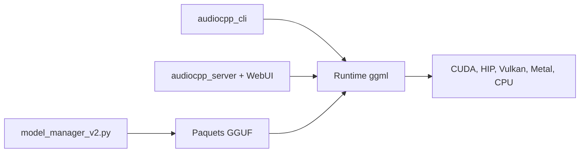

# 0xShug0/audio.cpp

> Moteur C++ basé sur ggml qui exécute en local des modèles audio (synthèse vocale, transcription, séparation), pour développeurs.

## Le problème
Essayer des modèles audio oblige à jongler avec de nombreux environnements Python et leurs conflits de dépendances.

## Ce que ça fait vraiment
Fournit un runtime natif unique pour 143 familles de modèles audio (TTS, ASR, clonage de voix, séparation, musique, VAD, diarisation) via une CLI, une API serveur et une WebUI embarquée. Backends : CUDA, HIP/ROCm, Vulkan, Metal, WebGPU, CPU. Les modèles sont distribués en GGUF.

## Comment c'est branché
Schéma simplifié d'après la fiche, sans diagramme fourni.



## Essayer
```bash
brew tap 0xShug0/audio-cpp
brew trust 0xShug0/audio-cpp
brew install audio-cpp
audiocpp_server --ui --ui-management --backend cuda
audiocpp_model_manager install qwen3_asr_0_6b_q8_0 --models-dir models
```

## Coût et pièges
Gratuit, mais les modèles pèsent lourd et un GPU aide beaucoup. Les paquets sont aussi disponibles en Docker. Les noyaux HIP et plusieurs backends sont encore marqués expérimentaux ou en test.

## Ce que ce n'est pas
Ce n'est pas un seul modèle : c'est un moteur qui en charge beaucoup. Les chiffres de vitesse viennent du README, sans mesure indépendante. La licence existe mais n'est pas identifiée par GitHub.

## Alternatives
Aucune alternative nommée dans le README (il se compare à des implémentations Python de référence).

## Pour toi
À adopter pour tester des modèles TTS/ASR en local sans environnement Python, en vérifiant d'abord la licence et le mainteneur unique.

