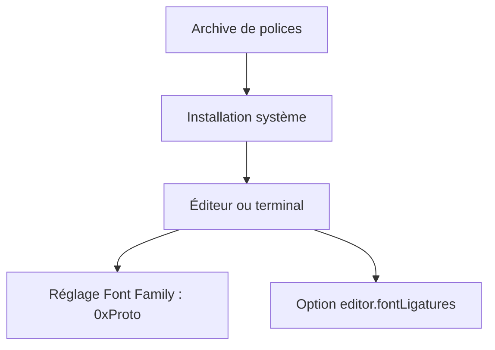

# 0xType/0xProto

> Monospaced typeface for code, designed to clearly distinguish neighbouring characters.

## The problem
At small sizes, characters like 0/O or l/1/I get confused and let errors slip through.

## What it actually does
Provides font files: distinct shapes, wide interiors for small sizes, "texture healing" that slightly widens letters like `m`, more white space. Ligatures that change meaning (`!=` into `≠`) are refused. Variants without ligatures (NL) and "Zx Proto". Script variant `ss01` in italic.

## How it is wired
Simplified diagram based on the sheet, no diagram provided.



## Trying it
```bash
# README : pas de commande, installation manuelle :
# télécharger l'archive, la dézipper, puis installer les fichiers de police
# (Font Book sur macOS, clic droit > Installer sur Windows).
# VS Code : Settings > Text Editor > Font > Font Family = "0xProto"
```

## Cost and gotchas
Free, OFL-1.1 licence. Nothing to compile, but you must choose between the version with or without ligatures.

## What it is not
Not a software tool: a simple typographic asset. It does not replace a ligature font if you like them.

## Alternatives
Fira Code, recommended by the author if you want ligatures.

## For you
Ignore as a watch topic: pure reading comfort, worth testing in two minutes if you want to change your editor font.
