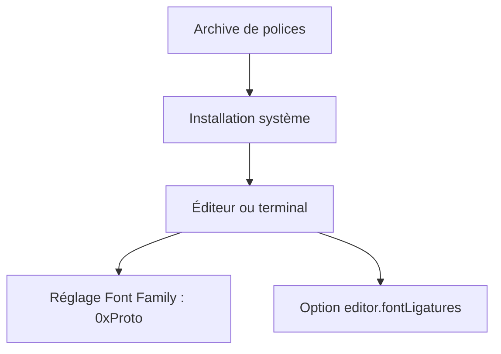

# 0xType/0xProto

> Police de caractères à chasse fixe pour le code, pensée pour distinguer nettement les caractères voisins.

## Le problème
Dans les petites tailles, des caractères comme 0/O ou l/1/I se confondent et font passer des erreurs.

## Ce que ça fait vraiment
Fournit des fichiers de police : formes distinctes, intérieurs larges pour les petits corps, « texture healing » qui élargit légèrement des lettres comme `m`, plus d'espace blanc. Les ligatures qui changent le sens (`!=` en `≠`) sont refusées. Variantes sans ligatures (NL) et « Zx Proto ». Variante script `ss01` en italique.

## Comment c'est branché
Schéma simplifié d'après la fiche, sans diagramme fourni.



## Essayer
```bash
# README : pas de commande, installation manuelle :
# télécharger l'archive, la dézipper, puis installer les fichiers de police
# (Font Book sur macOS, clic droit > Installer sur Windows).
# VS Code : Settings > Text Editor > Font > Font Family = "0xProto"
```

## Coût et pièges
Gratuit, licence OFL-1.1. Rien à compiler, mais choisir entre version avec ou sans ligatures.

## Ce que ce n'est pas
Pas un outil logiciel : un simple actif typographique. Il ne remplace pas une police à ligatures si tu les aimes.

## Alternatives
Fira Code, recommandé par l'auteur si tu veux des ligatures.

## Pour toi
À ignorer comme sujet de veille : pur confort de lecture, à tester en deux minutes si tu veux changer de police d'éditeur.

