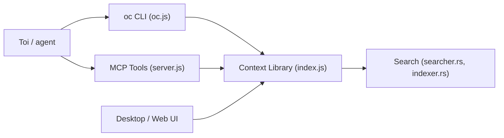

# 0xranx/OpenContext

> Personal context library, exposed through CLI and MCP, that your coding agent reads and feeds.

## The problem
The assistant forgets decisions and context from one day, repository or chat to the next, and you repeat yourself.

## What it actually does
A global library of Markdown folders and documents, with search, driven by the `oc` CLI. `oc init` generates skills and slash commands for Cursor, Claude Code and Codex (`/opencontext-context`, `-search`, `-create`, `-iterate`) and an MCP config. A desktop app and a web UI allow editing.

## How it is wired


## Trying it
```bash
npm install -g @aicontextlab/cli
cd your-project
oc init
oc search "query"
oc ui
```

## Cost and gotchas
Free; reuses your existing agent CLI (no extra subscription). `oc init` writes into your user folders (`~/.claude`, `~/.cursor`, `~/.codex`). The README points to the website for search and the FAQ.

## What it is not
Not an automatic memory: you organize and persist the documents yourself. The README says "see the repository for the license" while the catalog indicates MIT.

## Alternatives
The README names no alternative.

## For you
Worth watching: a useful idea if you juggle several coding agents, but a young project, with a single maintainer, writing into global configs.
