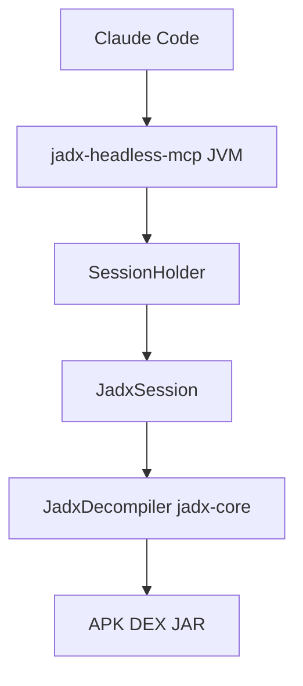

# 1013503897/jadx-headless-mcp

> Headless MCP server that exposes the jadx-core decompiler to a model for analyzing Android APKs.

## The problem
Analyzing an APK with jadx goes through a graphical interface designed for a human, which the model cannot drive.

## What it actually does
A single JVM process speaks MCP over stdio (or HTTP as an option) and offers about 26 tools: load an APK, read the manifest, list and decompile classes to Java with smali fallback, find cross-references, read strings and resources. Decompilation is lazy, with a maximum delay of 90 seconds per class.

## How it is wired


## Trying it
```bash
./gradlew installDist
./build/install/jadx-headless-mcp/bin/jadx-headless-mcp
claude mcp add jadx-headless -s user -- java -jar C:/tools/jadx-headless-mcp-<version>-all.jar
```
A Claude Code plugin also exists: `/plugin marketplace add 1013503897/jadx-headless-mcp`.

## Cost and gotchas
Free. You need a JDK 17 or later (not listed in the prerequisites) and enough RAM for a large APK. In HTTP mode, there is no authentication: stay on 127.0.0.1 or behind a tunnel.

## What it is not
Not an offensive tool: it reads and decompiles, it exploits nothing. It loads a single APK per process and only covers the Java layer, not native code.

## Alternatives
zinja-coder/jadx-ai-mcp and zinja-coder/jadx-mcp-server: plugin for the jadx interface and Python adapter. mobilehackinglab/jadx-mcp-plugin: another plugin for the interface.

## For you
Worth watching: a clear example of an MCP tool that needs to be well bounded, useful if you analyze mobile applications with a model; otherwise marginal.
