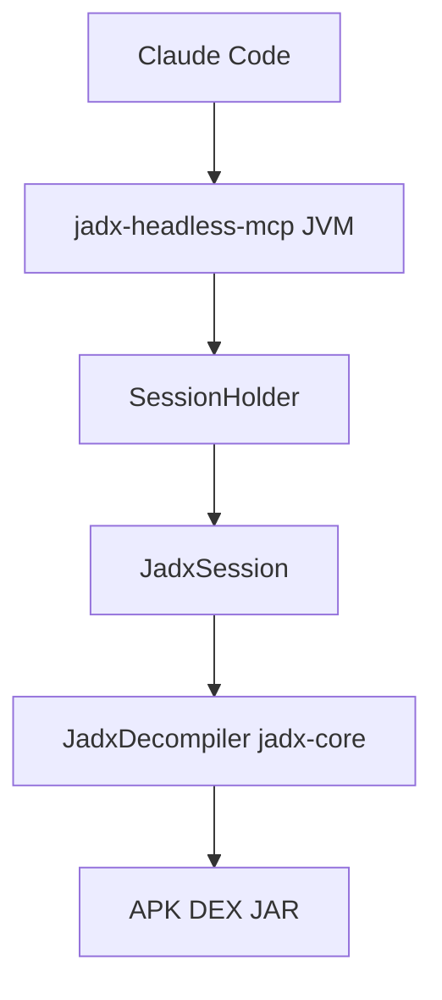

# 1013503897/jadx-headless-mcp

> Serveur MCP sans interface qui expose le décompilateur jadx-core à un modèle pour analyser des APK Android.

## Le problème
L'analyse d'un APK avec jadx passe par une interface graphique conçue pour un humain, que le modèle ne peut pas piloter.

## Ce que ça fait vraiment
Un processus JVM unique parle MCP par stdio (ou HTTP en option) et propose environ 26 outils : charger un APK, lire le manifeste, lister et décompiler des classes en Java avec repli smali, trouver les références croisées, lire chaînes et ressources. La décompilation est paresseuse, avec un délai maximal de 90 secondes par classe.

## Comment c'est branché


## Essayer
```bash
./gradlew installDist
./build/install/jadx-headless-mcp/bin/jadx-headless-mcp
claude mcp add jadx-headless -s user -- java -jar C:/tools/jadx-headless-mcp-<version>-all.jar
```
Un plugin Claude Code existe aussi : `/plugin marketplace add 1013503897/jadx-headless-mcp`.

## Coût et pièges
Gratuit. Il faut un JDK 17 ou plus (non listé dans les prérequis) et assez de RAM pour un gros APK. En mode HTTP, aucune authentification : reste sur 127.0.0.1 ou derrière un tunnel.

## Ce que ce n'est pas
Pas un outil offensif : il lit et décompile, il n'exploite rien. Il charge un seul APK par processus et ne couvre que la couche Java, pas le code natif.

## Alternatives
zinja-coder/jadx-ai-mcp et zinja-coder/jadx-mcp-server : plugin pour l'interface jadx et adaptateur Python. mobilehackinglab/jadx-mcp-plugin : autre plugin pour l'interface.

## Pour toi
À surveiller : exemple net d'outil MCP à bien borner, utile si tu analyses des applications mobiles avec un modèle ; sinon marginal.

