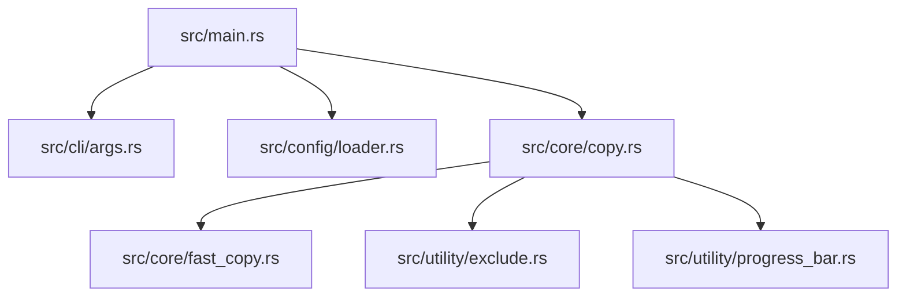

# 11happy/cpx

> Replacement for `cp` written in Rust for Linux, with parallelism, progress bar and resume.

## The problem
`cp` shows no progress, does not resume an interrupted copy and copies large file trees serially.

## What it actually does
Parallel copy (4 tasks by default), progress bar, resume with checksum verification, gitignore-style exclusions, sparse files preserved, reflink/CoW when possible. README measurements: 141 ms versus 415 ms for `cp` on 63,000 files (cpx -j16). Of 68 ported GNU tests, 49 pass and 10 differ deliberately.

## How it is wired


## Trying it
```bash
cargo install cpx
cpx -r source_dir/ dest_dir/
cpx -r --resume large_dataset/ /backup/
cpx -r -e "node_modules" -e ".git" my-project/ /backup/
```

## Cost and gotchas
Linux only. The install script goes through `curl ... | bash`: prefer `cargo install`. Ten behaviors differ from GNU `cp`.

## What it is not
Not a remote synchronization tool nor an `rsync`. Gains measured on tmpfs with a warm cache, not on network disk.

## Alternatives
No alternative named in the README.

## For you
Watch: useful for moving large datasets with resume, to test on your real storage before replacing `cp`.
