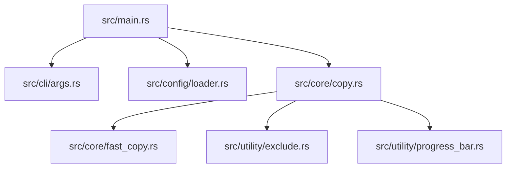

# 11happy/cpx

> Remplaçant de `cp` écrit en Rust pour Linux, avec parallélisme, barre de progression et reprise.

## Le problème
`cp` ne montre aucune progression, ne reprend pas une copie interrompue et copie les gros arbres de fichiers en série.

## Ce que ça fait vraiment
Copie parallèle (4 tâches par défaut), barre de progression, reprise avec vérification de somme de contrôle, exclusions façon gitignore, fichiers creux conservés, reflink/CoW si possible. Mesures du README : 141 ms contre 415 ms pour `cp` sur 63 000 fichiers (cpx -j16). Sur 68 tests GNU portés, 49 passent et 10 diffèrent volontairement.

## Comment c'est branché


## Essayer
```bash
cargo install cpx
cpx -r source_dir/ dest_dir/
cpx -r --resume large_dataset/ /backup/
cpx -r -e "node_modules" -e ".git" my-project/ /backup/
```

## Coût et pièges
Linux uniquement. Le script d'installation passe par `curl ... | bash` : préférer `cargo install`. Dix comportements diffèrent de GNU `cp`.

## Ce que ce n'est pas
Pas un outil de synchronisation distante ni un `rsync`. Gains mesurés sur tmpfs avec cache chaud, pas sur disque réseau.

## Alternatives
Aucune alternative nommée dans le README.

## Pour toi
Surveiller : utile pour déplacer de gros jeux de données avec reprise, à tester sur ton stockage réel avant de remplacer `cp`.

