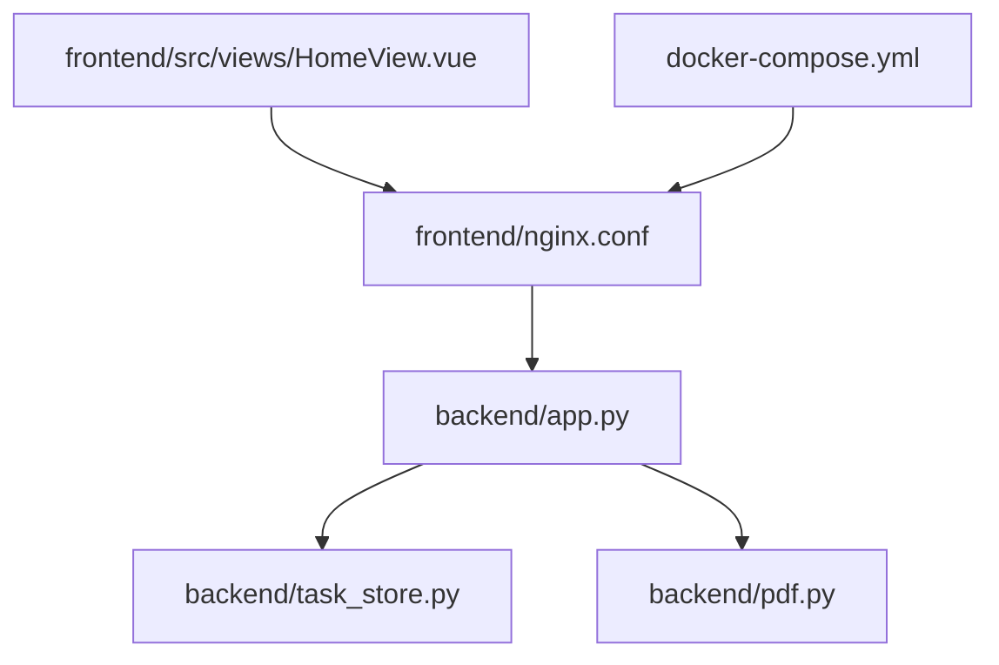

# 14790897/handwriting-web

> Website that turns text into images or PDFs of simulated handwriting using fonts.

## The problem
Getting text that looks handwritten without writing by hand.

## What it actually does
Vue frontend and FastAPI backend: upload of fonts and backgrounds, settings for margins, character perturbation and ink, text extraction from files (PDF, docs), preview, ZIP export of images or PDF. Rendering is asynchronous with a SQLite task queue and WebSocket tracking. A desktop version exists.

## How it is wired


## Trying it
```bash
docker-compose up -d
cd backend && pip install -r requirements.txt && python app.py
cd frontend && npm install && npm run serve
```

## Cost and gotchas
Free. Docker on port 2345, CPU limited by default. Locally: Python 3.8 to 3.13, Node 14 or later. README in Chinese.

## What it is not
Not an AI model for generating handwriting: it applies existing fonts with randomness.

## Alternatives
No alternative named in the README.

## For you
Ignore: a formatting tool unrelated to data/AI; its obvious use, schoolwork in disguise, is questionable.
