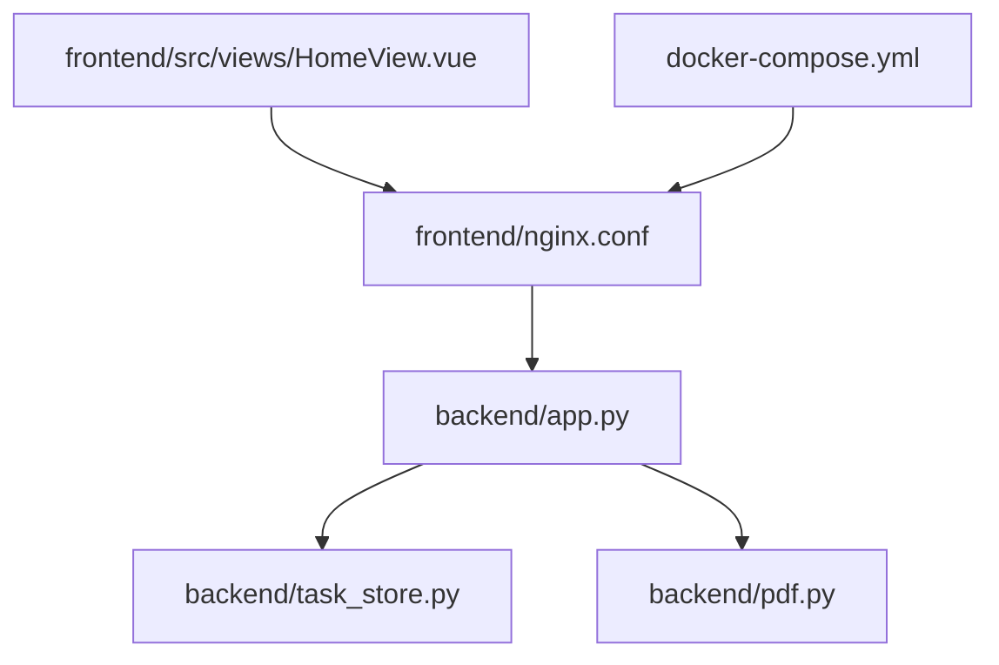

# 14790897/handwriting-web

> Site qui transforme du texte en images ou PDF d'écriture manuscrite simulée à partir de polices.

## Le problème
Obtenir un rendu de texte qui ressemble à du manuscrit sans écrire à la main.

## Ce que ça fait vraiment
Frontend Vue et backend FastAPI : upload de polices et de fonds, réglages de marges, de perturbation des caractères et d'encre, extraction de texte depuis des fichiers (PDF, docs), aperçu, export ZIP d'images ou PDF. Le rendu est asynchrone avec file de tâches SQLite et suivi par WebSocket. Une version de bureau existe.

## Comment c'est branché


## Essayer
```bash
docker-compose up -d
cd backend && pip install -r requirements.txt && python app.py
cd frontend && npm install && npm run serve
```

## Coût et pièges
Gratuit. Docker sur le port 2345, CPU limité par défaut. En local : Python 3.8 à 3.13, Node 14 ou plus. README en chinois.

## Ce que ce n'est pas
Pas un modèle d'IA de génération d'écriture : il applique des polices existantes avec du hasard.

## Alternatives
Aucune alternative nommée dans le README.

## Pour toi
Ignorer : outil de mise en forme sans lien avec data/IA ; son usage évident, du travail scolaire déguisé, est discutable.

