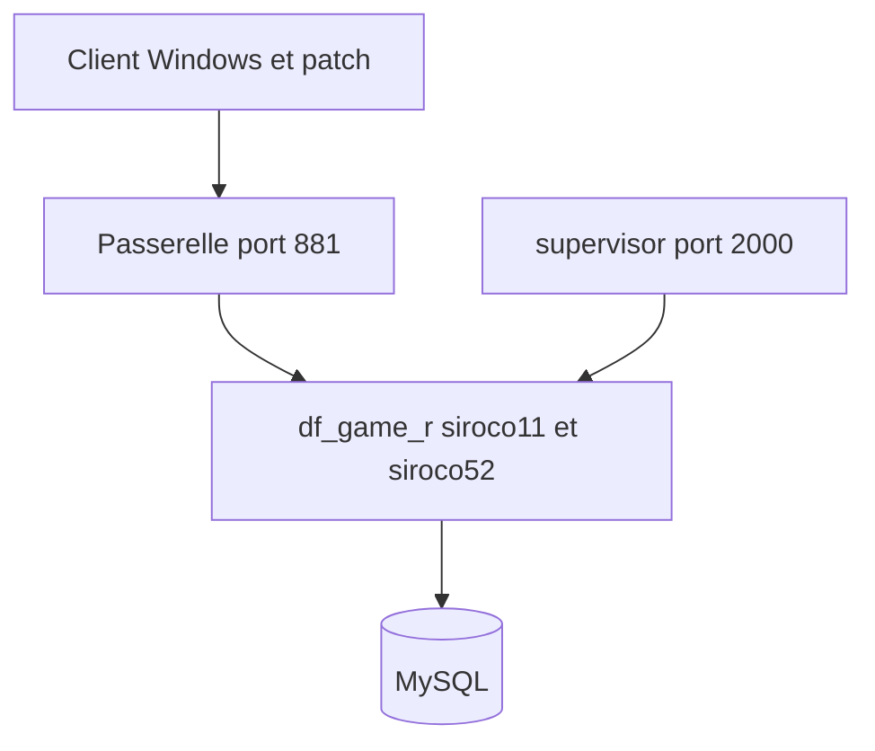

# 1995chen/dnf

> Docker image of a private Dungeon and Fighter game server, for learning purposes.

## The problem
Setting up the game server by hand requires configuring CentOS, MySQL, the process manager and many ports.

## What it actually does
A Docker image based on CentOS 5, 6 or 7 that bundles the game server, MySQL and a process manager (supervisor). Settings go through environment variables (`PUBLIC_IP`, `GM_ACCOUNT`, `GM_PASSWORD`) and initialization scripts. The README also describes the client, the gateway and the FAQ. It is in Chinese.

## How it is wired
Simplified diagram based on the fiche, no diagram provided.



## Trying it
```bash
mkdir -p /data/log /data/mysql /data/data
docker restart dnf
```
The full `docker run`, with its many options and ports, is in the README.

## Cost and gotchas
Free, but memory-hungry: `--shm-size=8g` is mandatory, and the process may be killed for lack of RAM. No ARM support. The default credentials are public and must be changed.

## What it is not
Not a production server: the author forbids using it to open a public server. The clients and patches come from Baidu share links, to be verified.

## Alternatives
- XanderYe/dnf and llnut/dnf: neighboring images, cited in the README.

## For you
Ignore: outside your domain, with downloads of dubious origin and game-only use.
