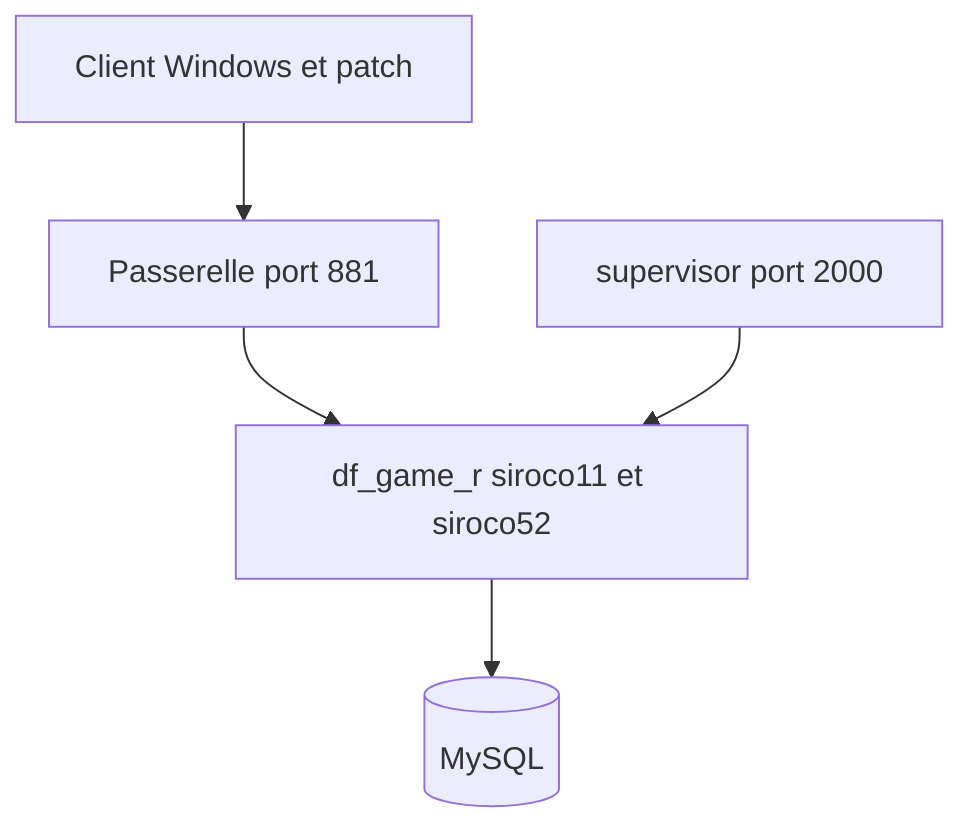

# 1995chen/dnf

> Image Docker d'un serveur privé du jeu Dungeon and Fighter, pour apprentissage.

## Le problème
Monter un serveur du jeu à la main demande de configurer CentOS, MySQL, le gestionnaire de processus et de nombreux ports.

## Ce que ça fait vraiment
Une image Docker fondée sur CentOS 5, 6 ou 7 qui regroupe le serveur de jeu, MySQL et un gestionnaire de processus (supervisor). Les réglages passent par des variables d'environnement (`PUBLIC_IP`, `GM_ACCOUNT`, `GM_PASSWORD`) et des scripts d'initialisation. Le README décrit aussi le client, la passerelle et la foire aux questions. Il est en chinois.

## Comment c'est branché
Schéma simplifié d'après la fiche, sans diagramme fourni.



## Essayer
```bash
mkdir -p /data/log /data/mysql /data/data
docker restart dnf
```
Le `docker run` complet, avec ses nombreuses options et ports, figure dans le README.

## Coût et pièges
Gratuit, mais gourmand en mémoire : `--shm-size=8g` est obligatoire, et le processus peut être tué faute de RAM. Pas de support ARM. Les identifiants par défaut sont publics et à changer.

## Ce que ce n'est pas
Pas un serveur de production : l'auteur interdit de l'utiliser pour ouvrir un serveur public. Les clients et patchs viennent de liens de partage Baidu, à vérifier.

## Alternatives
- XanderYe/dnf et llnut/dnf : images voisines, cités dans le README.

## Pour toi
À ignorer : hors de ton domaine, avec des téléchargements de provenance douteuse et un usage de jeu seulement.

