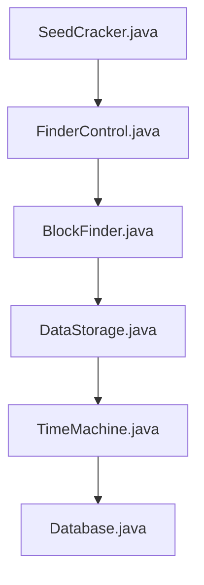

# 19MisterX98/SeedcrackerX

> Fabric client mod that recovers a Minecraft world's seed from observed structures, for players.

## The problem
A Minecraft server's seed is not displayed; recovering it requires a computation from terrain clues.

## What it actually does
The mod observes structures, decorators, biomes and End pillars, stores these clues and runs a staged search. It needs 40 "liftable" bits and 32 normal bits from 1.18 onward. It offers commands, a settings interface, rendering of found elements and optional sharing of seeds to a Google Sheet.

## How it is wired


## Trying it
No command-line installation: Fabric, then drop the `.jar` into the mods folder. In-game commands:
```bash
/seedcracker gui
/seedcracker data bits
```

## Cost and gotchas
Free, Minecraft license required. The database option sends seeds of servers with more than 10 players to a Google spreadsheet. The nether is no longer supported.

## What it is not
It is not a neutral tool: it is used to discover the seed of third-party servers. Only the GitHub repository and the CurseForge page are official.

## Alternatives
The README cites Nether_Bedrock_Cracker for the nether.

## For you
Ignore: a game mod unrelated to your work.
