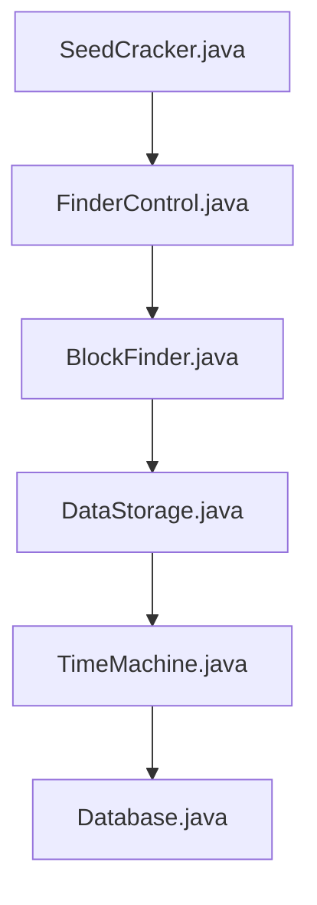

# 19MisterX98/SeedcrackerX

> Mod Fabric client qui retrouve la graine d'un monde Minecraft à partir des structures observées, pour joueurs.

## Le problème
La graine d'un serveur Minecraft n'est pas affichée ; la retrouver demande un calcul à partir d'indices du terrain.

## Ce que ça fait vraiment
Le mod observe structures, décorateurs, biomes et piliers de l'End, stocke ces indices et lance une recherche par étapes. Il faut 40 bits « liftables » et 32 bits normaux à partir de 1.18. Il propose commandes, interface de réglage, rendu des éléments trouvés et un partage optionnel de graines vers un Google Sheet.

## Comment c'est branché


## Essayer
Pas d'installation en ligne de commande : Fabric, puis déposer le `.jar` dans le dossier mods. Commandes en jeu :
```bash
/seedcracker gui
/seedcracker data bits
```

## Coût et pièges
Gratuit, licence Minecraft requise. L'option base de données envoie les graines de serveurs de plus de 10 joueurs vers un tableur Google. Le nether n'est plus géré.

## Ce que ce n'est pas
Ce n'est pas un outil neutre : il sert à découvrir la graine de serveurs tiers. Seuls le dépôt GitHub et la page CurseForge sont officiels.

## Alternatives
Le README cite Nether_Bedrock_Cracker pour le nether.

## Pour toi
À ignorer : mod de jeu sans lien avec ton métier.

