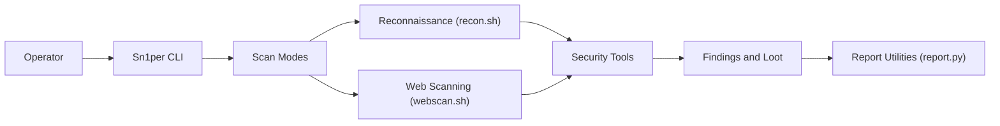

# 1N3/Sn1per

> A command-line platform that chains reconnaissance, scanning and reporting for authorized penetration testers.

## The problem
A penetration test requires assembling dozens of tools by hand (mapping, port scan, web scan, report). Sn1per orchestrates them in a single flow.

## What it actually does
- `sniper` command with modes (normal, stealth, web, discover on a CIDR, "mass" variants on a target list).
- Orchestrates 90+ third-party tools (Nmap, Nessus, OpenVAS, Burp, ZAP, Metasploit, Shodan...); results go into "workspaces" and a `loot` directory.
- Schedulable scans (daily/weekly/monthly) and export of results.
- Web interface, JSON API and PDF/Excel reports: paid edition, not verifiable in the Community tree.

## How it is wired


## Trying it
```bash
git clone https://github.com/1N3/Sn1per.git
cd Sn1per
sudo bash install.sh
sniper -t example.com -m normal
```

## Cost and gotchas
Community edition is free under a custom EULA (license not identified by GitHub, to be read); Professional at $984/year per seat, Enterprise on quote. Installation as root in `/usr/share/sniper`, Docker container launched with `--privileged`.

## What it is not
- A dual-use tool: to be used only on systems you have written authorization to security-test; scanning third parties is illegal in most countries.
- Not open source in the strict sense: "source-available".
- A wrapper: the value depends on the third-party tools installed.

## Alternatives
No alternative named in the README, apart from the tools it integrates (Nuclei, Nessus, OpenVAS).

## For you
To watch: useful only if you do pentesting or ASM; custom license to re-read and flagship features reserved for the paid offer, so of little relevance for a data / AI profile.
