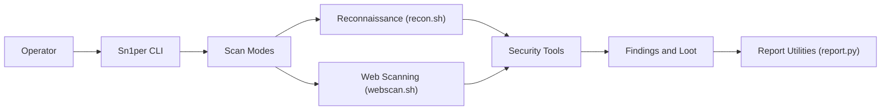

# 1N3/Sn1per

> Plateforme en ligne de commande qui enchaîne reconnaissance, scan et reporting pour les testeurs d'intrusion autorisés.

## Le problème
Un test d'intrusion demande d'assembler à la main des dizaines d'outils (cartographie, scan de ports, scan web, rapport). Sn1per les orchestre dans un seul flux.

## Ce que ça fait vraiment
- Commande `sniper` avec des modes (normal, stealth, web, discover sur un CIDR, variantes « mass » sur liste de cibles).
- Orchestre 90+ outils tiers (Nmap, Nessus, OpenVAS, Burp, ZAP, Metasploit, Shodan…) ; les résultats vont dans des « workspaces » et un répertoire `loot`.
- Scans planifiables (daily/weekly/monthly) et export des résultats.
- Interface web, API JSON et rapports PDF/Excel : édition payante, pas vérifiables dans l'arbre Community.

## Comment c'est branché


## Essayer
```bash
git clone https://github.com/1N3/Sn1per.git
cd Sn1per
sudo bash install.sh
sniper -t example.com -m normal
```

## Coût et pièges
Édition Community gratuite sous EULA personnalisée (licence non identifiée par GitHub, à lire) ; Professional à 984 $/an par siège, Enterprise sur devis. Installation en root dans `/usr/share/sniper`, conteneur Docker lancé en `--privileged`.

## Ce que ce n'est pas
- Outil à double usage : à employer uniquement sur des systèmes dont on a l'autorisation écrite de tester la sécurité ; scanner des tiers est illégal dans la plupart des pays.
- Pas open source au sens strict : « source-available ».
- Un wrapper : la valeur dépend des outils tiers installés.

## Alternatives
Aucune alternative nommée dans le README, hormis les outils qu'il intègre (Nuclei, Nessus, OpenVAS).

## Pour toi
Surveiller : utile seulement si tu fais du pentest ou de l'ASM ; licence personnalisée à relire et fonctions phares réservées à l'offre payante, donc peu pertinent pour un profil data / IA.

