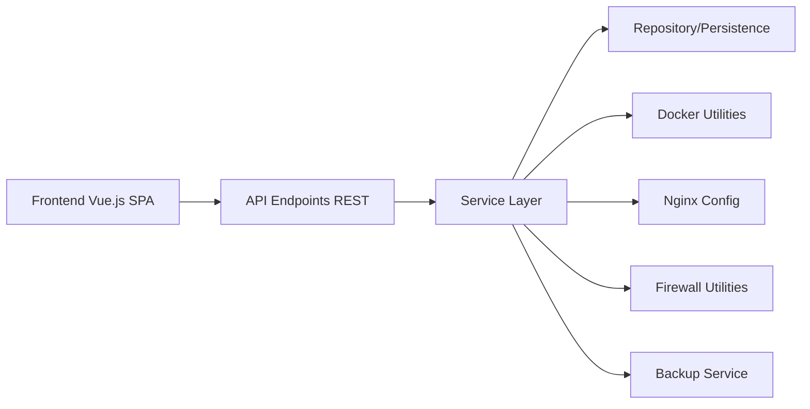

# 1Panel-dev/1Panel

> Web admin panel for Linux servers, with a containerized app store, for self-hosters.

## The problem
Administering a Linux server (sites, databases, containers, SSL, backups) from the command line is slow and error-prone.

## What it actually does
A Vue.js web interface driving a Go backend (REST API v1, service layer, repository) that manages Docker, Nginx, firewall, files, SSL and backups to the cloud.
A store of 165+ apps installed in one click as containers; WordPress/Halo deployment with domain and certificate.
An "AI" side: gateway and Skills Hub, agents (OpenClaw) limited to 5 in the open-source edition.
Paid Pro/Ent editions: multi-node, anti-defacement, AI gateway, KVM.

## How it is wired


## Trying it
```bash
bash -c "$(curl -sSL https://resource.1panel.pro/v2/quick_start.sh)"
1pctl user-info
```

## Cost and gotchas
`curl | bash` install script to run as root on the server. Several features (multi-node, advanced WAF, AI gateway) are reserved for paid editions.

## What it is not
Not a multi-server orchestrator in the free version. Not an MLOps tool: the AI side is an agent-management layer, not a model platform.

## Alternatives
- cPanel / Plesk: historical references, proprietary and paid.
- aaPanel: also has an app store, partly open source.
- Webmin: free, but development judged slow by the README.

## For you
Useful for a personal VPS hosting services; off-topic for data/AI work.
