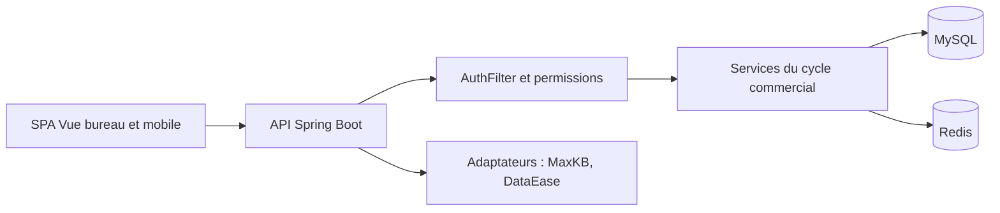

# 1Panel-dev/CordysCRM

> Open-source self-hosted CRM with AI features, for sales teams that want to keep their data.

## The problem
SaaS CRMs host customer data at the vendor and integrate poorly with internal tools; a self-hosted CRM requires setting up the stack.

## What it actually does
Spring Boot backend (Maven modules), MySQL, Redis, Vue clients for desktop and mobile. Sales cycle: leads, customers, opportunities, quotes, contracts, invoices, orders, with configurable forms and fields, approvals, exports, notifications. Integrations: MaxKB (AI agents), DataEase (BI), DingTalk, Lark, WeCom, SSO. A "CRM Skills" interface opens access to external assistants, including OpenClaw.

## How it is wired


## Trying it
```bash
docker run -d \
  --name cordys-crm \
  --restart unless-stopped \
  -p 8081:8081 \
  -p 8082:8082 \
  -v ~/cordys:/opt/cordys \
  1panel/cordys-crm
```

## Cost and gotchas
Free, a Linux server with Docker. The README publishes the initial login and password (`admin` / `CordysCRM`): change them immediately. License not identified by GitHub: check before commercial use.

## What it is not
Not a data tool: it is a business application. The README and documentation are in Chinese.

## Alternatives
No alternative named in the README (same publisher: DataEase, MaxKB).

## For you
Keep an eye on it: interesting for seeing a CRM + agents architecture, but without a CRM need of your own it brings nothing to a data/AI profile, and the license must be cleared first.
