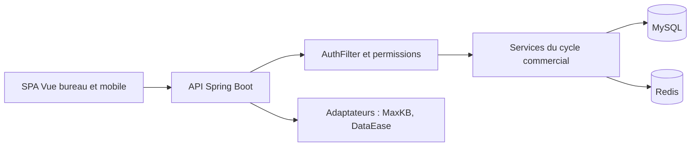

# 1Panel-dev/CordysCRM

> CRM open source auto-hébergé avec fonctions IA, pour équipes commerciales qui veulent garder leurs données.

## Le problème
Les CRM SaaS hébergent les données clients chez l'éditeur et s'intègrent mal aux outils internes ; un CRM auto-hébergé exige de monter la pile.

## Ce que ça fait vraiment
Backend Spring Boot (modules Maven), MySQL, Redis, clients Vue pour bureau et mobile. Cycle commercial : pistes, clients, opportunités, devis, contrats, factures, commandes, avec formulaires et champs configurables, approbations, exports, notifications. Intégrations : MaxKB (agents IA), DataEase (BI), DingTalk, Lark, WeCom, SSO. Une interface « CRM Skills » ouvre l'accès à des assistants externes, dont OpenClaw.

## Comment c'est branché


## Essayer
```bash
docker run -d \
  --name cordys-crm \
  --restart unless-stopped \
  -p 8081:8081 \
  -p 8082:8082 \
  -v ~/cordys:/opt/cordys \
  1panel/cordys-crm
```

## Coût et pièges
Gratuit, un serveur Linux avec Docker. Le README publie l'identifiant et le mot de passe initiaux (`admin` / `CordysCRM`) : à changer immédiatement. Licence non identifiée par GitHub : à vérifier avant usage commercial.

## Ce que ce n'est pas
Pas un outil data : c'est une application métier. Le README et la documentation sont en chinois.

## Alternatives
Aucune alternative nommée dans le README (même éditeur : DataEase, MaxKB).

## Pour toi
À surveiller : intéressant pour voir une architecture CRM + agents, mais sans besoin de CRM propre, il n'apporte rien à un profil data/IA, et la licence est à lever d'abord.

