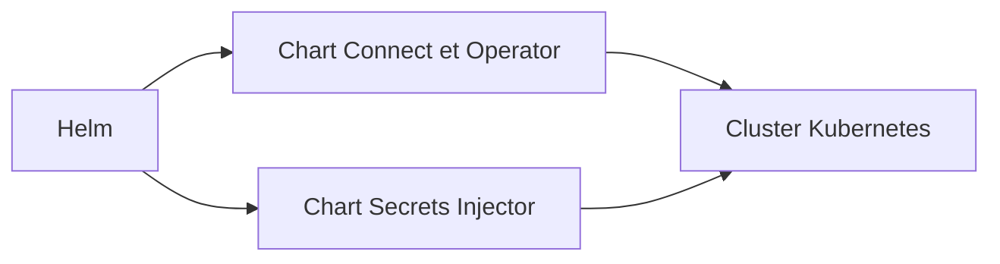

# 1Password/connect-helm-charts

> Helm charts to deploy 1Password Connect, its Kubernetes operator and its secrets injector.

## The problem
Providing 1Password secrets to Kubernetes applications by hand is manual and exposes the secrets.

## What it actually does
The README is very short: it lists two charts, one for 1Password Connect with the Kubernetes operator, the other for the secrets injector. Detailed operation is not documented here.

## How it is wired
Simplified diagram based on the sheet, no diagram provided.



## Trying it
```bash
helm repo add 1password https://1password.github.io/connect-helm-charts
```

## Cost and gotchas
You need a 1Password account, whose plan is paid, and a Kubernetes cluster with Helm. The APIs are subject to 1Password's terms of service.

## What it is not
Not a standalone secrets manager: it depends on the 1Password service. MIT license on the charts only.

## Alternatives
No alternative named in the README.

## For you
Ignore unless your team already uses 1Password with Kubernetes: an integration building block tied to a SaaS.
