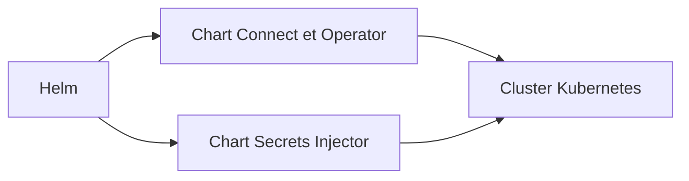

# 1Password/connect-helm-charts

> Charts Helm pour déployer 1Password Connect, son opérateur Kubernetes et son injecteur de secrets.

## Le problème
Fournir des secrets 1Password à des applications Kubernetes à la main est manuel et expose les secrets.

## Ce que ça fait vraiment
Le README est très court : il liste deux charts, l'un pour 1Password Connect avec l'opérateur Kubernetes, l'autre pour l'injecteur de secrets. Le fonctionnement détaillé n'est pas documenté ici.

## Comment c'est branché
Schéma simplifié d'après la fiche, sans diagramme fourni.



## Essayer
```bash
helm repo add 1password https://1password.github.io/connect-helm-charts
```

## Coût et pièges
Il faut un compte 1Password, dont l'offre est payante, et un cluster Kubernetes avec Helm. Les API sont soumises aux conditions de service de 1Password.

## Ce que ce n'est pas
Pas un gestionnaire de secrets autonome : il dépend du service 1Password. Licence MIT sur les charts seulement.

## Alternatives
Aucune alternative nommée dans le README.

## Pour toi
À ignorer sauf si ton équipe utilise déjà 1Password avec Kubernetes : brique d'intégration liée à un SaaS.

