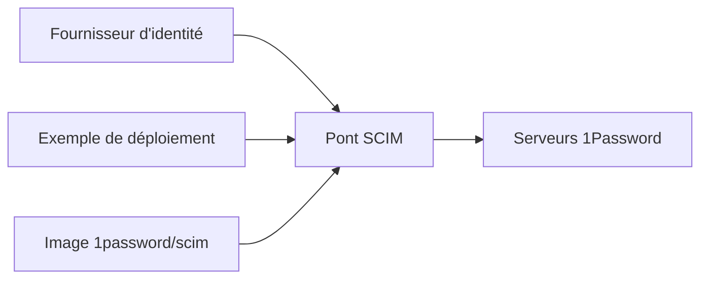

# 1Password/scim-examples

> Examples for deploying the 1Password SCIM bridge on Azure, AWS, GCP, DigitalOcean, Docker and Kubernetes.

## The problem
Connecting an identity provider to 1Password to provision accounts requires deploying a SCIM bridge on your own infrastructure.

## What it actually does
Contains no software of its own: examples (ARM, CloudFormation, Terraform, Helm, kubectl, Docker Swarm) that all pull the same public `1password/scim` image from Docker Hub. Beta and deprecated examples are filed separately.

## How it is wired

## Trying it
No command documented in this README; each example has its own page.

## Cost and gotchas
A 1Password account and an identity provider are required; the chosen cloud infrastructure is at your expense. The Marketplace option requires a public DNS record.

## What it is not
Not the SCIM bridge itself (that is the Docker image), nor a general-purpose tool. The "Automated Provisioning" option hosted by 1Password avoids this deployment for Entra ID and Okta.

## Alternatives
Automated provisioning hosted by 1Password for Entra ID and Okta (cited in the README).

## For you
Ignore: only useful if you administer 1Password in a company, unrelated to data or MLOps.
