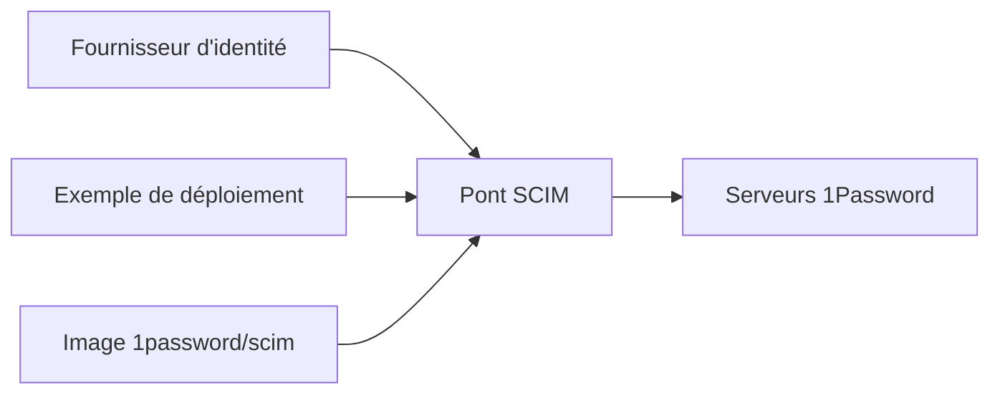

# 1Password/scim-examples

> Exemples de déploiement du pont SCIM de 1Password sur Azure, AWS, GCP, DigitalOcean, Docker et Kubernetes.

## Le problème
Brancher un fournisseur d'identité à 1Password pour provisionner les comptes demande de déployer un pont SCIM sur sa propre infrastructure.

## Ce que ça fait vraiment
Ne contient pas de logiciel propre : des exemples (ARM, CloudFormation, Terraform, Helm, kubectl, Docker Swarm) qui tirent tous la même image publique `1password/scim` de Docker Hub. Des exemples bêta et dépréciés sont classés à part.

## Comment c'est branché

## Essayer
Aucune commande documentée dans ce README ; chaque exemple a sa propre page.

## Coût et pièges
Il faut un compte 1Password et un fournisseur d'identité ; l'infrastructure cloud choisie est à ta charge. Le choix Marketplace impose un enregistrement DNS public.

## Ce que ce n'est pas
Pas le pont SCIM lui-même (c'est l'image Docker), ni un outil généraliste. L'option « Automated Provisioning » hébergée par 1Password évite ce déploiement pour Entra ID et Okta.

## Alternatives
Provisionnement automatisé hébergé par 1Password pour Entra ID et Okta (cité dans le README).

## Pour toi
À ignorer : utile uniquement si tu administres 1Password en entreprise, sans lien avec la data ou le MLOps.

