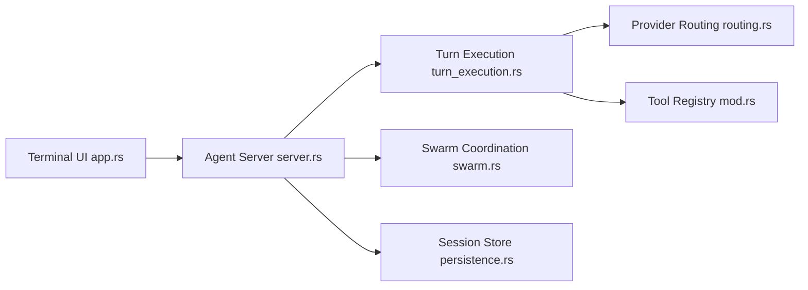

# 1jehuang/jcode

> Terminal coding agent that runs dozens of parallel sessions with little memory.

## The problem
Popular coding agents consume hundreds of megabytes per session and start slowly when you launch several.

## What it actually does
An agent server with a TUI and persistent sessions. "Swarm" mode: several agents in the same repository, notified when another modifies a file they have read, with direct messaging or broadcast; an agent can launch its own squad. Claude and Codex OAuth login, MCP, memory, ambient scheduler and a "self-dev" mode where the agent modifies its own code. README benchmarks: 71.3 MB for the first session, about 3.3 MB per additional session.

## How it is wired


## Trying it
```bash
curl -fsSL https://jcode.sh/install | bash
```

## Cost and gotchas
Subscription or provider key at your expense. The install script comes from the `jcode.sh` domain. Benchmarks provided by the author, with a reproduction link. 753 open issues.

## What it is not
Not a multi-user platform: the README documents no team authentication. Self-dev mode modifies the tool's own binary.

## Alternatives
Numerical comparison with OpenCode, pi, Claude Code and Codex CLI.

## For you
Worth watching: interesting if you run many agents in parallel on a limited machine; validate the measurements on your hardware.
