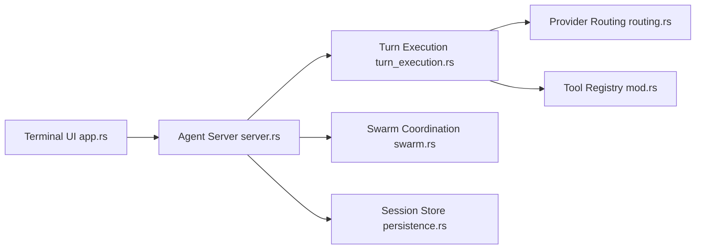

# 1jehuang/jcode

> Agent de code en terminal qui lance des dizaines de sessions en parallèle avec peu de mémoire.

## Le problème
Les agents de code populaires consomment des centaines de mégaoctets par session et démarrent lentement quand on en lance plusieurs.

## Ce que ça fait vraiment
Un serveur d'agents avec TUI et sessions persistantes. Mode « swarm » : plusieurs agents dans le même dépôt, notifiés quand un autre modifie un fichier qu'ils ont lu, avec messagerie directe ou diffusion ; un agent peut lancer sa propre escouade. Connexion OAuth Claude et Codex, MCP, mémoire, planificateur ambiant et mode « self-dev » où l'agent modifie son propre code. Benchmarks du README : 71,3 Mo pour la première session, environ 3,3 Mo par session supplémentaire.

## Comment c'est branché


## Essayer
```bash
curl -fsSL https://jcode.sh/install | bash
```

## Coût et pièges
Abonnement ou clé de fournisseur à ta charge. Le script d'installation vient du domaine `jcode.sh`. Benchmarks fournis par l'auteur, avec lien de reproduction. 753 issues ouvertes.

## Ce que ce n'est pas
Pas une plateforme multi-utilisateurs : le README ne documente pas d'authentification d'équipe. Le mode self-dev modifie le binaire de l'outil lui-même.

## Alternatives
Comparaison chiffrée avec OpenCode, pi, Claude Code et Codex CLI.

## Pour toi
À surveiller : intéressant si tu fais tourner beaucoup d'agents en parallèle sur une machine limitée ; valide les mesures sur ton matériel.

